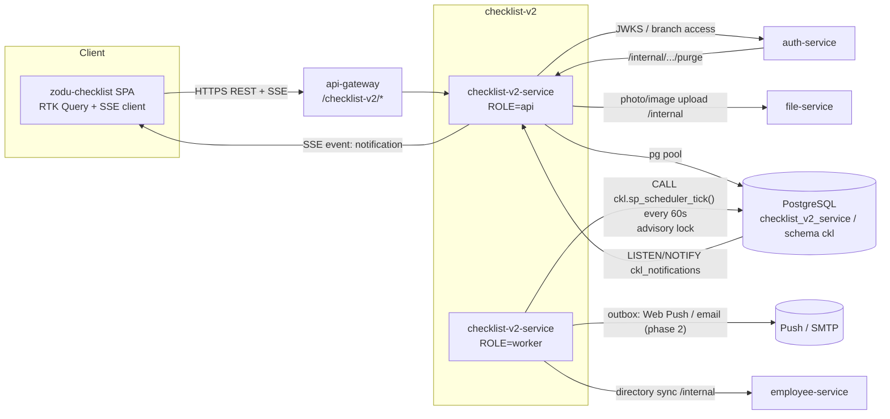
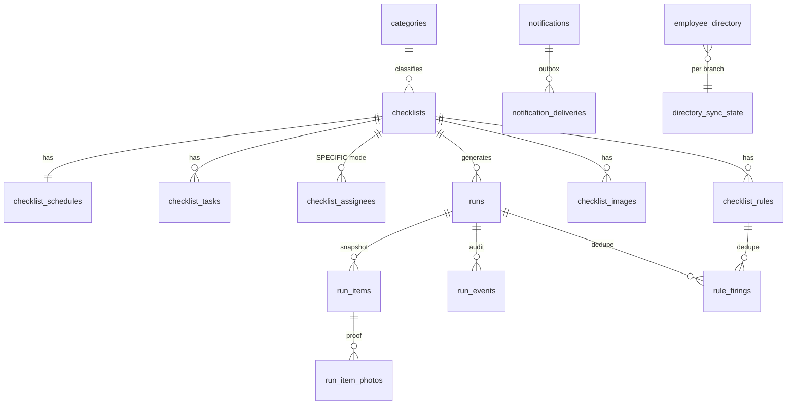
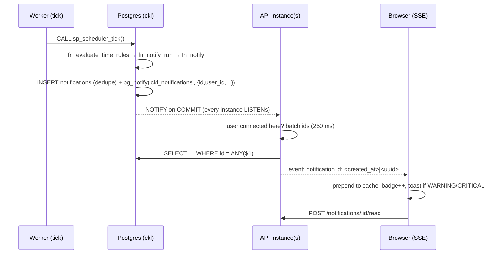
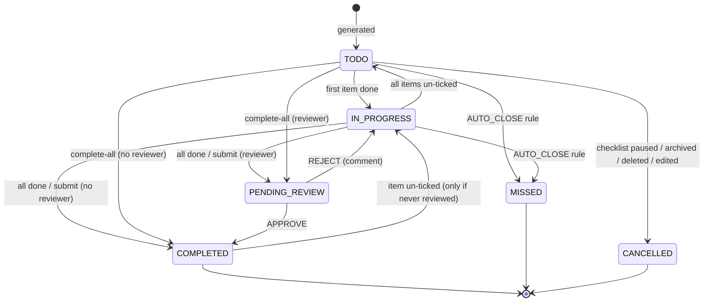

# zodu Checklist v2 — Backend Architecture & Implementation Plan

| | |
|---|---|
| **New service** | `checklist-v2-service` (folder `zodu-merged-backend/checklist-v2-service`) |
| **New database** | `checklist_v2_service`, all objects in schema `ckl` |
| **Gateway prefix** | `/checklist-v2` → service routes `/api/*` |
| **Ports** | 4008 local · 3008 UAT/prod (3000–3007, 4007, 5000 are taken) |
| **Frontend** | `zodu-checklist` (React 19 + MUI 7 + RTK Query) |
| **Old service** | `checklist-service` and its DB stay untouched until cut-over (§15) |
| **Postgres** | 14 or newer (procedures with `COMMIT`, `EXECUTE FUNCTION` triggers) |

**Rule of thumb used throughout:** time-driven and rule-driven work (recurring run generation, reminders, overdue, escalation, auto-close, missed streaks, notification fan-out) lives in **PL/pgSQL procedures, functions and triggers**. Everything a user does (create, list, tick an item, review, read notifications) goes through the **REST API**. Anything that needs the network (employee lookups, file uploads, push/email delivery) stays in **Node**, because the database cannot make HTTP calls.

---

## Contents

1. [What exists today (findings)](#1-what-exists-today-findings)
2. [Target architecture](#2-target-architecture)
3. [Service layout](#3-service-layout)
4. [Database design](#4-database-design)
5. [Procedures, functions and triggers](#5-procedures-functions-and-triggers)
6. [Rule engine](#6-rule-engine)
7. [Notification architecture](#7-notification-architecture)
8. [REST API](#8-rest-api)
9. [Run lifecycle (state machine)](#9-run-lifecycle-state-machine)
10. [Security, tenancy, permissions](#10-security-tenancy-permissions)
11. [Changes in other services and infra](#11-changes-in-other-services-and-infra)
12. [Frontend plan](#12-frontend-plan)
13. [Testing strategy](#13-testing-strategy)
14. [Operations: observability, performance, retention](#14-operations-observability-performance-retention)
15. [Rollout plan and task checklist](#15-rollout-plan-and-task-checklist)
16. [Risks and how each is handled](#16-risks-and-how-each-is-handled)

---

## 1. What exists today (findings)

### 1.1 Backend (`zodu-merged-backend`)

- Node 24 / Express 4 microservices behind `api-gateway` (http-proxy-middleware). Each service: `src/{api,config,database,repository,schema,security,services,utils}`, `pg` pool, Joi validation, winston logging, Dockerfile built from the repo root so `packages/zodu-security` can be copied in.
- `@zodu/security` gives every service: `applySecurity`, ES256 access-token checks against auth-service's JWKS, tenant from token (`req.tenant.zoduId / branchId`), route policy (`crud()`, `perm`, `authenticated`), `requireInternal('<caller>')` with `INTERNAL_TOKEN_<CALLER>` env tokens, `internalHeaders()` for outbound calls.
- Response convention: `{ success: true, data, pagination }` / `{ success: false, error }`.
- `checklist-service` (the old one):
  - Recurrence only supports Daily/Weekly/Monthly/Yearly with "every N" and an end date.
  - It had **both** a pg_cron job (`table.query.sql`) and a Node scheduler calling `generate_checklist_instances()`; "Overdue" was stored in one place and derived in another.
  - One global `CHECKLIST_TIMEZONE`, no per-branch time zone.
  - Item status is shared across assignees in one table and per-employee in another.
  - No notifications, no categories, priority, reviewer, photo proof, per-task settings or rules.
- Branch / company deletion: auth-service runs `branchPurgeClient.js` / `companyPurgeClient.js`, calling `/internal/.../purge` on every service. **A new service must join those lists**, or deleted tenants leave data behind.
- `scripts/apply-migrations.sh` tracks applied files per DB in `tbl_schema_migrations`. It never creates databases.

### 1.2 Frontend (`zodu-checklist`)

- The Checklist board, the Create Checklist drawer, templates (AdminView) and the dashboard all run on **sample data** (`board.ts → sampleBoard`, `data.ts → SAMPLE_TEMPLATES`, `created.ts → runsFor`). Only `getOccurrences` is wired to the old service.
- The form already defines the full product model the backend must store:
  - **Recurrence** (`recurrence.ts`): Once/Recurring; Hourly (with an operating window or 24/7), Daily (weekdays only), Weekly (multiple weekdays), Monthly (day N or nth weekday, with "last"); every N; trigger time; effective from; ends Never / After N occurrences / On date.
  - **Checklist fields**: name, description, category, priority (High/Medium/Low), up to 6 images (5 MB each), Assign To All / Specific, Review Approver, up to 50 tasks (title, instructions, require photo, allow notes).
  - **Settings**: require photo proof, allow partial, allow notes, enable reminders, auto close after due time.
  - **Board**: one row per assignee per run, with statuses To Do / In Progress / Overdue / Completed, progress `done/total`, reassign, complete all.
- Top bar: the bell is a static `<Badge variant="dot">` with no data behind it.
- `recurrence.ts` says "the form and the board can never disagree". The backend must keep that promise, so §13.2 adds shared test vectors that run against both the TypeScript and the SQL implementations.

### 1.3 What this design changes

| Problem today | v2 answer |
|---|---|
| Recurrence model too small for the UI | `checklist_schedules` stores every field of the frontend `Recurrence` 1:1 |
| Two schedulers (pg_cron + Node) | One Node worker calls `CALL ckl.sp_scheduler_tick()` every minute under an advisory lock. All logic is in SQL. |
| Stored vs derived "Overdue" | Never stored: `open AND due_at < now()`. One-off overdue *events* are tracked in `rule_firings`. |
| Single global time zone | Per-checklist `timezone` (branch time zone). Every run has a real `timestamptz` `due_at`. |
| Editing a checklist rewrites history | Runs **snapshot** title, tasks and settings when generated. Edits only regenerate future, untouched runs. |
| No notifications | In-app inbox, live SSE push, per-user preferences, quiet hours, and an outbox for Web Push / email later |
| No rules | Event–condition–action rules per checklist, evaluated by SQL (time rules) and triggers (event rules) |

---

## 2. Target architecture



**One image, two roles.** The same Docker image starts as `ROLE=api` (HTTP + SSE + LISTEN) or `ROLE=worker` (scheduler tick, directory sync, delivery dispatcher). API replicas scale with traffic. The worker runs as one replica; a second one is safe because the advisory lock and `SKIP LOCKED` prevent double work.

**Why the database owns scheduling and rules.**

- They are set-based operations over many rows. In SQL they run in one round trip and in one transaction with the data they change, so no event can be half-applied.
- Idempotency comes from constraints (`UNIQUE (checklist_id, slot_at, assignee)`, `rule_firings` primary key, `UNIQUE (recipient_user_id, dedupe_key)`), not from application code. Retries, restarts and overlapping workers cannot create duplicates.
- Event rules (submitted, completed, missed, reassigned) live in a trigger. A status change always produces its notifications, whichever code path made it.

---

## 3. Service layout

```
checklist-v2-service/
├── Dockerfile                    # same pattern as checklist-service (root build context)
├── package.json
├── .env.example
├── migrations/
│   ├── V001__schema.sql
│   ├── V002__recurrence_functions.sql
│   ├── V003__generation.sql
│   ├── V004__notifications.sql
│   ├── V005__rules.sql
│   └── V006__scheduler.sql
├── src/
│   ├── server.js                 # reads ROLE: starts api or worker
│   ├── api-app.js                # express app (security, routes, error handler)
│   ├── worker.js                 # tick loop, directory sync, delivery dispatcher
│   ├── config/index.js
│   ├── database/
│   │   ├── pool.js               # pg Pool (max 20, statement_timeout 15s)
│   │   ├── tx.js                 # withTransaction(fn, { actorUserId }) → SET LOCAL ckl.actor_user_id
│   │   └── listener.js           # dedicated pg.Client: LISTEN ckl_notifications, auto-reconnect
│   ├── security/{index.js,request.js,rules.js}
│   ├── api/
│   │   ├── checklists.controller.js
│   │   ├── runs.controller.js
│   │   ├── categories.controller.js
│   │   ├── dashboard.controller.js
│   │   ├── notifications.controller.js   # incl. GET /notifications/stream (SSE)
│   │   ├── health.controller.js
│   │   └── internal.controller.js        # purge branch / company
│   ├── schema/                   # Joi schemas (checklist, schedule, rules, run actions, prefs)
│   ├── services/                 # business logic, one per controller
│   ├── repository/               # SQL only, parameterised, tenant-scoped
│   ├── realtime/sse-hub.js       # userId → Set<res>, heartbeat, fan-out, backpressure
│   ├── jobs/
│   │   ├── scheduler-tick.js     # advisory lock + CALL ckl.sp_scheduler_tick()
│   │   ├── directory-sync.js     # employee-service → ckl.employee_directory
│   │   └── delivery-dispatcher.js# outbox → Web Push / email (phase 2)
│   ├── clients/{employee.js,file.js}     # internalHeaders(), timeouts, retries
│   └── utils/{logger,errors,pagination,idempotency,time}.js
└── test/
    ├── fixtures/recurrence-vectors.json  # shared with the frontend (§13.2)
    ├── sql/*.test.js                      # procedures against a real Postgres
    └── api/*.test.js                      # supertest
```

### 3.1 Dependencies

`express`, `pg`, `joi`, `winston`, `morgan`, `multer`, `uuid`, `dotenv`, `@zodu/security` (file dependency). Phase 2 adds `web-push` and optionally `prom-client`. Dev: `jest`, `supertest`, `nodemon`.

### 3.2 Environment (`.env.example`)

```dotenv
PORT=4008
ROLE=api                         # api | worker
DB_HOSTNAME=localhost
DB_PORT=5432
DB_USERNAME=
DB_PASSWORD=
DB_NAME=checklist_v2_service
DB_POOL_MAX=20
DB_STATEMENT_TIMEOUT_MS=15000

DEFAULT_TIMEZONE=Asia/Kolkata    # used when a branch has no time zone
GENERATION_HORIZON_HOURS=36
TICK_INTERVAL_MS=60000
DIRECTORY_SYNC_INTERVAL_MS=600000

AUTH_SERVICE_URL=http://auth-service:4000
EMPLOYEE_SERVICE_URL=http://employee-service:4002
FILE_SERVICE_URL=http://file-service:4007

INTERNAL_TOKEN=                  # this service's own token (sent as X-Internal-Token)
INTERNAL_TOKEN_AUTH=             # accepted caller: auth-service (purge)

AUTH_ALLOW_REQUESTED_BRANCH=true
ACCESS_CACHE_TTL_MS=60000
AUTH_CHECK_REVOKED_SESSIONS=false

SSE_HEARTBEAT_MS=20000
SSE_MAX_STREAMS_PER_USER=5

# Phase 2 (Web Push)
VAPID_PUBLIC_KEY=
VAPID_PRIVATE_KEY=
VAPID_SUBJECT=mailto:support@zodu.in
```

### 3.3 Process behaviour

- **api**: `applySecurity(app, { cors: false, ipLimitPerMinute: 0, bodyLimit: '1mb' })`; `/internal` behind `requireInternal('auth')`; then `security.middleware`; routes; error handler. On start it opens the LISTEN connection.
  - `/health/live` returns 200 while the process is up.
  - `/health/ready` returns 200 only when the DB answers `SELECT 1` and the LISTEN client is connected.
- **worker**: one dedicated `pg.Client` for the tick (not from the pool, so `statement_timeout` and the session advisory lock never leak into the pool).
  - Tick loop: `setTimeout` chain (no overlap). `SET statement_timeout = 55s`, then `pg_try_advisory_lock(7260801)`, then `CALL ckl.sp_scheduler_tick()`, then unlock.
  - Readiness: the last tick in `ckl.job_state` is less than 3 minutes old.
- **Graceful shutdown (SIGTERM)**: stop accepting connections; send SSE clients `retry: 3000` and end their streams; wait for an in-flight tick (max 30s); `pool.end()`.
- `unhandledRejection` / `uncaughtException`: log and exit 1. Docker's `restart: always` brings the process back.

---

## 4. Database design

### 4.1 Conventions

- Database `checklist_v2_service`, schema `ckl`. Every object is schema-qualified. This matters because procedures that `COMMIT` cannot carry a `SET search_path` clause.
- Every tenant table has `zodu_id VARCHAR(50)` and `branch_id VARCHAR(50)` (same types as the other services), and every index used by the API leads with them.
- `uuid` primary keys (`gen_random_uuid()`), `timestamptz` for instants, `date` only for local calendar days.
- Enums are `VARCHAR` + `CHECK`, which is easier to migrate than `CREATE TYPE`. API values are UPPER_SNAKE; the frontend maps them to labels.
- `row_version INT` on rows users edit concurrently (optimistic locking). `updated_at` is maintained by a trigger.
- Soft delete (`deleted_at`) for checklists only. Runs are history and are never deleted by users.
- DB roles: `ckl_owner` owns objects and runs migrations. `ckl_app` (the service login) gets `USAGE` on the schema, DML on tables and `EXECUTE` on functions/procedures, with no DDL.

### 4.2 Entity overview



### 4.3 DDL — `V001__schema.sql`

```sql
CREATE SCHEMA IF NOT EXISTS ckl;
CREATE EXTENSION IF NOT EXISTS pgcrypto;   -- gen_random_uuid() on PG < 13

-- ── shared trigger: updated_at ───────────────────────────────────────────────
CREATE OR REPLACE FUNCTION ckl.trg_touch_updated_at() RETURNS trigger
LANGUAGE plpgsql AS $$ BEGIN NEW.updated_at := now(); RETURN NEW; END $$;

-- ── 1. categories (global defaults: zodu_id NULL; tenants may add their own) ─
CREATE TABLE ckl.categories (
  id          uuid PRIMARY KEY DEFAULT gen_random_uuid(),
  zodu_id     varchar(50),
  name        varchar(60)  NOT NULL,
  color       char(7)      NOT NULL DEFAULT '#1D4ED8',
  icon        varchar(40),
  sort_order  smallint     NOT NULL DEFAULT 0,
  is_active   boolean      NOT NULL DEFAULT true,
  created_at  timestamptz  NOT NULL DEFAULT now()
);
CREATE UNIQUE INDEX uq_categories_name ON ckl.categories (COALESCE(zodu_id, ''), lower(name));

INSERT INTO ckl.categories (zodu_id, name, color, icon, sort_order) VALUES
  (NULL, 'Operations',  '#1D4ED8', 'SettingsOutlined',        1),
  (NULL, 'Hygiene',     '#15803D', 'AutoAwesomeOutlined',     2),
  (NULL, 'Inventory',   '#0F766E', 'Inventory2Outlined',      3),
  (NULL, 'Safety',      '#B45309', 'ShieldOutlined',          4),
  (NULL, 'Maintenance', '#BE123C', 'BuildOutlined',           5)
ON CONFLICT DO NOTHING;

-- ── 2. per-branch code counter: CL-0001 ─────────────────────────────────────
CREATE TABLE ckl.checklist_code_counters (
  zodu_id   varchar(50) NOT NULL,
  branch_id varchar(50) NOT NULL,
  last_no   integer     NOT NULL,
  PRIMARY KEY (zodu_id, branch_id)
);

-- ── 3. checklists (the definition / template) ──────────────────────────────
CREATE TABLE ckl.checklists (
  id                    uuid PRIMARY KEY DEFAULT gen_random_uuid(),
  zodu_id               varchar(50)  NOT NULL,
  branch_id             varchar(50)  NOT NULL,
  code                  varchar(20)  NOT NULL,
  name                  varchar(150) NOT NULL,
  description           text,
  category_id           uuid REFERENCES ckl.categories(id),
  priority              varchar(6)   NOT NULL DEFAULT 'MEDIUM' CHECK (priority IN ('HIGH','MEDIUM','LOW')),
  status                varchar(8)   NOT NULL DEFAULT 'ACTIVE' CHECK (status IN ('ACTIVE','PAUSED','ARCHIVED')),
  assign_mode           varchar(8)   NOT NULL CHECK (assign_mode IN ('ALL','SPECIFIC')),
  reviewer_employee_id  uuid,
  timezone              varchar(64)  NOT NULL DEFAULT 'Asia/Kolkata',
  require_photo         boolean      NOT NULL DEFAULT true,
  allow_partial         boolean      NOT NULL DEFAULT true,
  allow_notes           boolean      NOT NULL DEFAULT true,
  created_by_user_id    uuid         NOT NULL,
  created_by_name       varchar(100) NOT NULL,
  updated_by_user_id    uuid,
  updated_by_name       varchar(100),
  row_version           integer      NOT NULL DEFAULT 1,
  created_at            timestamptz  NOT NULL DEFAULT now(),
  updated_at            timestamptz  NOT NULL DEFAULT now(),
  deleted_at            timestamptz,
  CONSTRAINT uq_checklists_code UNIQUE (zodu_id, branch_id, code)
);
CREATE INDEX idx_checklists_tenant ON ckl.checklists (zodu_id, branch_id, status) WHERE deleted_at IS NULL;
CREATE TRIGGER trg_checklists_touch BEFORE UPDATE ON ckl.checklists
  FOR EACH ROW EXECUTE FUNCTION ckl.trg_touch_updated_at();

-- ── 4. tasks (the items of a checklist; runs copy them) ─────────────────────
CREATE TABLE ckl.checklist_tasks (
  id             uuid PRIMARY KEY DEFAULT gen_random_uuid(),
  checklist_id   uuid NOT NULL REFERENCES ckl.checklists(id) ON DELETE CASCADE,
  position       smallint     NOT NULL CHECK (position BETWEEN 1 AND 50),
  title          varchar(300) NOT NULL,
  instructions   text,
  require_photo  boolean NOT NULL DEFAULT false,
  allow_notes    boolean NOT NULL DEFAULT true,
  CONSTRAINT uq_tasks_position UNIQUE (checklist_id, position) DEFERRABLE INITIALLY DEFERRED
);

-- ── 5. schedule (1:1 with the frontend Recurrence type) ────────────────────
CREATE TABLE ckl.checklist_schedules (
  checklist_id          uuid PRIMARY KEY REFERENCES ckl.checklists(id) ON DELETE CASCADE,
  task_type             varchar(10) NOT NULL CHECK (task_type IN ('ONCE','RECURRING')),
  frequency             varchar(8)  CHECK (frequency IN ('HOURLY','DAILY','WEEKLY','MONTHLY')),
  every_n               smallint    NOT NULL DEFAULT 1 CHECK (every_n BETWEEN 1 AND 99),
  all_day               boolean     NOT NULL DEFAULT false,
  window_start          time,
  window_end            time,
  weekdays_only         boolean     NOT NULL DEFAULT false,
  weekdays              smallint[]  NOT NULL DEFAULT '{}' CHECK (weekdays <@ ARRAY[0,1,2,3,4,5,6]::smallint[]),
  monthly_by            varchar(8)  CHECK (monthly_by IN ('DAY','WEEKDAY')),
  month_day             smallint    CHECK (month_day BETWEEN 1 AND 31),
  nth                   smallint    CHECK (nth IN (1,2,3,4,-1)),
  nth_weekday           smallint    CHECK (nth_weekday BETWEEN 0 AND 6),
  trigger_time          time,
  start_date            date        NOT NULL,
  ends                  varchar(8)  NOT NULL DEFAULT 'NEVER' CHECK (ends IN ('NEVER','AFTER','ON_DATE')),
  max_occurrences       integer     CHECK (max_occurrences BETWEEN 1 AND 999),
  end_date              date,
  -- generation state (owned by ckl.fn_generate_for_schedule)
  generated_until       timestamptz,          -- every slot <= this is generated or deliberately skipped
  occurrences_generated integer     NOT NULL DEFAULT 0,
  is_exhausted          boolean     NOT NULL DEFAULT false,
  updated_at            timestamptz NOT NULL DEFAULT now(),
  -- cross-field rules (mirror recurrenceErrors() in recurrence.ts)
  CONSTRAINT ck_freq_required    CHECK (task_type = 'ONCE' OR frequency IS NOT NULL),
  CONSTRAINT ck_time_required    CHECK (frequency = 'HOURLY' AND task_type = 'RECURRING' OR trigger_time IS NOT NULL),
  CONSTRAINT ck_hourly_window    CHECK (NOT (task_type = 'RECURRING' AND frequency = 'HOURLY' AND NOT all_day)
                                        OR (window_start IS NOT NULL AND window_end > window_start)),
  CONSTRAINT ck_hourly_every     CHECK (frequency IS DISTINCT FROM 'HOURLY' OR every_n <= 23),
  CONSTRAINT ck_weekly_days      CHECK (task_type = 'ONCE' OR frequency IS DISTINCT FROM 'WEEKLY' OR cardinality(weekdays) > 0),
  CONSTRAINT ck_monthly_pattern  CHECK (task_type = 'ONCE' OR frequency IS DISTINCT FROM 'MONTHLY'
                                        OR (monthly_by = 'DAY' AND month_day IS NOT NULL)
                                        OR (monthly_by = 'WEEKDAY' AND nth IS NOT NULL AND nth_weekday IS NOT NULL)),
  CONSTRAINT ck_ends_after       CHECK (ends <> 'AFTER'   OR max_occurrences IS NOT NULL),
  CONSTRAINT ck_ends_on_date     CHECK (ends <> 'ON_DATE' OR (end_date IS NOT NULL AND end_date >= start_date))
);
CREATE INDEX idx_schedules_due ON ckl.checklist_schedules (generated_until NULLS FIRST) WHERE NOT is_exhausted;

-- ── 6. specific assignees ──────────────────────────────────────────────────
CREATE TABLE ckl.checklist_assignees (
  checklist_id  uuid NOT NULL REFERENCES ckl.checklists(id) ON DELETE CASCADE,
  employee_id   uuid NOT NULL,
  PRIMARY KEY (checklist_id, employee_id)
);

-- ── 7. rules (§6) ──────────────────────────────────────────────────────────
CREATE TABLE ckl.checklist_rules (
  id                   uuid PRIMARY KEY DEFAULT gen_random_uuid(),
  checklist_id         uuid NOT NULL REFERENCES ckl.checklists(id) ON DELETE CASCADE,
  rule_type            varchar(30) NOT NULL CHECK (rule_type IN (
                         'REMIND_BEFORE_DUE','NOTIFY_ON_OVERDUE','ESCALATE_AFTER_OVERDUE','AUTO_CLOSE',
                         'NOTIFY_REVIEWER_ON_SUBMIT','NOTIFY_ON_COMPLETE','MISSED_STREAK')),
  offset_min           integer  NOT NULL DEFAULT 0 CHECK (offset_min BETWEEN 0 AND 10080),
  threshold            smallint CHECK (threshold BETWEEN 2 AND 30),
  target               varchar(10) NOT NULL DEFAULT 'ASSIGNEE' CHECK (target IN ('ASSIGNEE','REVIEWER','CREATOR','CUSTOM')),
  target_employee_ids  uuid[]   NOT NULL DEFAULT '{}',
  channels             varchar(10)[] NOT NULL DEFAULT '{IN_APP}'
                         CHECK (channels <@ ARRAY['IN_APP','WEB_PUSH','EMAIL']::varchar[]),
  is_active            boolean  NOT NULL DEFAULT true,
  created_at           timestamptz NOT NULL DEFAULT now(),
  CONSTRAINT ck_streak_threshold CHECK (rule_type <> 'MISSED_STREAK' OR threshold IS NOT NULL),
  CONSTRAINT ck_custom_targets   CHECK (target <> 'CUSTOM' OR cardinality(target_employee_ids) > 0),
  CONSTRAINT uq_rule UNIQUE (checklist_id, rule_type, offset_min, target)
);
CREATE INDEX idx_rules_checklist ON ckl.checklist_rules (checklist_id) WHERE is_active;

-- ── 8. images on a checklist (stored in file-service) ──────────────────────
CREATE TABLE ckl.checklist_images (
  id                   uuid PRIMARY KEY DEFAULT gen_random_uuid(),
  checklist_id         uuid NOT NULL REFERENCES ckl.checklists(id) ON DELETE CASCADE,
  file_id              varchar(100) NOT NULL,
  file_name            varchar(255) NOT NULL,
  position             smallint NOT NULL CHECK (position BETWEEN 1 AND 6),
  uploaded_by_user_id  uuid NOT NULL,
  created_at           timestamptz NOT NULL DEFAULT now(),
  CONSTRAINT uq_image_position UNIQUE (checklist_id, position)
);

-- ── 9. employee directory (read model synced from employee-service) ────────
CREATE TABLE ckl.employee_directory (
  zodu_id            varchar(50)  NOT NULL,
  branch_id          varchar(50)  NOT NULL,
  employee_id        uuid         NOT NULL,
  user_id            uuid,                      -- NULL = employee without a login (gets runs, no notifications)
  employee_name      varchar(100) NOT NULL,
  is_active          boolean      NOT NULL DEFAULT true,
  source_updated_at  timestamptz,
  synced_at          timestamptz  NOT NULL DEFAULT now(),
  PRIMARY KEY (zodu_id, branch_id, employee_id)
);
CREATE INDEX idx_directory_user ON ckl.employee_directory (user_id, zodu_id, branch_id) WHERE user_id IS NOT NULL;

CREATE TABLE ckl.directory_sync_state (
  zodu_id            varchar(50) NOT NULL,
  branch_id          varchar(50) NOT NULL,
  last_success_at    timestamptz,
  last_full_sync_at  timestamptz,
  cursor_updated_at  timestamptz,
  last_error         text,
  PRIMARY KEY (zodu_id, branch_id)
);

-- ── 10. runs (one per checklist × slot × assignee) ─────────────────────────
CREATE TABLE ckl.runs (
  id                       uuid PRIMARY KEY DEFAULT gen_random_uuid(),
  zodu_id                  varchar(50)  NOT NULL,
  branch_id                varchar(50)  NOT NULL,
  checklist_id             uuid NOT NULL REFERENCES ckl.checklists(id),
  slot_at                  timestamptz  NOT NULL,        -- the trigger moment
  run_date                 date         NOT NULL,        -- local day of slot_at (board filter)
  sequence_no              integer      NOT NULL,
  assignee_employee_id     uuid         NOT NULL,
  assignee_name            varchar(100) NOT NULL,
  -- snapshot of the definition at generation time
  title                    varchar(150) NOT NULL,
  description              text,
  category_id              uuid,
  category_name            varchar(60),
  priority                 varchar(6)   NOT NULL,
  frequency                varchar(8)   NOT NULL,        -- HOURLY..MONTHLY | ONE_TIME
  reviewer_employee_id     uuid,
  requires_review          boolean      NOT NULL DEFAULT false,
  allow_partial            boolean      NOT NULL DEFAULT true,
  available_at             timestamptz  NOT NULL,
  due_at                   timestamptz  NOT NULL,
  -- state
  status                   varchar(16)  NOT NULL DEFAULT 'TODO'
                             CHECK (status IN ('TODO','IN_PROGRESS','PENDING_REVIEW','COMPLETED','MISSED','CANCELLED')),
  total_items              smallint     NOT NULL DEFAULT 0,
  done_items               smallint     NOT NULL DEFAULT 0 CHECK (done_items <= total_items),
  started_at               timestamptz,
  submitted_at             timestamptz,
  completed_at             timestamptz,
  reviewed_at              timestamptz,
  reviewed_by_employee_id  uuid,
  review_comment           varchar(1000),
  rejected_count           smallint     NOT NULL DEFAULT 0,
  row_version              integer      NOT NULL DEFAULT 1,
  created_at               timestamptz  NOT NULL DEFAULT now(),
  updated_at               timestamptz  NOT NULL DEFAULT now(),
  CONSTRAINT uq_run_slot UNIQUE (checklist_id, slot_at, assignee_employee_id)
);
CREATE INDEX idx_runs_board        ON ckl.runs (zodu_id, branch_id, run_date);
CREATE INDEX idx_runs_my_board     ON ckl.runs (zodu_id, branch_id, assignee_employee_id, run_date);
CREATE INDEX idx_runs_open_due     ON ckl.runs (due_at) WHERE status IN ('TODO','IN_PROGRESS');
CREATE INDEX idx_runs_streak       ON ckl.runs (checklist_id, assignee_employee_id, slot_at DESC);
CREATE INDEX idx_runs_review_queue ON ckl.runs (zodu_id, branch_id, reviewer_employee_id) WHERE status = 'PENDING_REVIEW';
CREATE TRIGGER trg_runs_touch BEFORE UPDATE ON ckl.runs
  FOR EACH ROW EXECUTE FUNCTION ckl.trg_touch_updated_at();

CREATE TABLE ckl.run_items (
  id                    uuid PRIMARY KEY DEFAULT gen_random_uuid(),
  run_id                uuid NOT NULL REFERENCES ckl.runs(id) ON DELETE CASCADE,
  position              smallint     NOT NULL,
  title                 varchar(300) NOT NULL,
  instructions          text,
  require_photo         boolean NOT NULL DEFAULT false,
  allow_notes           boolean NOT NULL DEFAULT true,
  is_done               boolean NOT NULL DEFAULT false,
  note                  varchar(1000),
  done_at               timestamptz,
  done_by_employee_id   uuid,
  CONSTRAINT uq_run_item_position UNIQUE (run_id, position)
);

CREATE TABLE ckl.run_item_photos (
  id                   uuid PRIMARY KEY DEFAULT gen_random_uuid(),
  run_item_id          uuid NOT NULL REFERENCES ckl.run_items(id) ON DELETE CASCADE,
  file_id              varchar(100) NOT NULL,
  file_name            varchar(255) NOT NULL,
  uploaded_by_user_id  uuid NOT NULL,
  created_at           timestamptz NOT NULL DEFAULT now()
);
CREATE INDEX idx_item_photos_item ON ckl.run_item_photos (run_item_id);

CREATE TABLE ckl.run_events (
  id             bigserial PRIMARY KEY,
  run_id         uuid NOT NULL REFERENCES ckl.runs(id) ON DELETE CASCADE,
  zodu_id        varchar(50) NOT NULL,
  branch_id      varchar(50) NOT NULL,
  event_type     varchar(20) NOT NULL,   -- STATUS_CHANGED | REASSIGNED | ITEM_DONE | ITEM_UNDONE | NOTE | PHOTO_ADDED
  from_status    varchar(16),
  to_status      varchar(16),
  actor_user_id  uuid,                    -- NULL = system (scheduler / rule)
  payload        jsonb NOT NULL DEFAULT '{}',
  created_at     timestamptz NOT NULL DEFAULT now()
);
CREATE INDEX idx_run_events_run ON ckl.run_events (run_id, created_at);

-- ── 11. rule firing ledger (exactly-once per rule × run) ───────────────────
CREATE TABLE ckl.rule_firings (
  rule_id   uuid NOT NULL REFERENCES ckl.checklist_rules(id) ON DELETE CASCADE,
  run_id    uuid NOT NULL REFERENCES ckl.runs(id) ON DELETE CASCADE,
  fired_at  timestamptz NOT NULL DEFAULT now(),
  error     text,
  PRIMARY KEY (rule_id, run_id)
);
CREATE INDEX idx_rule_firings_run ON ckl.rule_firings (run_id);

-- ── 12. notifications (in-app inbox) ───────────────────────────────────────
CREATE TABLE ckl.notifications (
  id                 uuid PRIMARY KEY DEFAULT gen_random_uuid(),
  zodu_id            varchar(50) NOT NULL,
  branch_id          varchar(50) NOT NULL,
  recipient_user_id  uuid        NOT NULL,
  type               varchar(30) NOT NULL,
  severity           varchar(8)  NOT NULL DEFAULT 'INFO' CHECK (severity IN ('INFO','WARNING','CRITICAL')),
  title              varchar(200) NOT NULL,
  body               varchar(500) NOT NULL,
  entity_type        varchar(20),
  entity_id          uuid,
  action_url         varchar(300),
  data               jsonb NOT NULL DEFAULT '{}',
  dedupe_key         varchar(200) NOT NULL,
  show_in_inbox      boolean NOT NULL DEFAULT true,
  read_at            timestamptz,
  created_at         timestamptz NOT NULL DEFAULT now(),
  expires_at         timestamptz NOT NULL DEFAULT now() + interval '90 days',
  CONSTRAINT uq_notification_dedupe UNIQUE (recipient_user_id, dedupe_key)
);
CREATE INDEX idx_notifications_inbox  ON ckl.notifications (recipient_user_id, zodu_id, branch_id, created_at DESC, id DESC) WHERE show_in_inbox;
CREATE INDEX idx_notifications_unread ON ckl.notifications (recipient_user_id, zodu_id, branch_id) WHERE show_in_inbox AND read_at IS NULL;
CREATE INDEX idx_notifications_expiry ON ckl.notifications (expires_at);

-- ── 13. outbox for external channels (phase 2 delivery) ────────────────────
CREATE TABLE ckl.notification_deliveries (
  id               uuid PRIMARY KEY DEFAULT gen_random_uuid(),
  notification_id  uuid NOT NULL REFERENCES ckl.notifications(id) ON DELETE CASCADE,
  channel          varchar(10) NOT NULL CHECK (channel IN ('WEB_PUSH','EMAIL')),
  status           varchar(8)  NOT NULL DEFAULT 'PENDING' CHECK (status IN ('PENDING','SENDING','SENT','FAILED','DEAD')),
  attempts         smallint    NOT NULL DEFAULT 0,
  next_attempt_at  timestamptz NOT NULL DEFAULT now(),
  locked_until     timestamptz,
  last_error       text,
  created_at       timestamptz NOT NULL DEFAULT now(),
  sent_at          timestamptz,
  CONSTRAINT uq_delivery UNIQUE (notification_id, channel)
);
CREATE INDEX idx_deliveries_pending ON ckl.notification_deliveries (next_attempt_at) WHERE status IN ('PENDING','SENDING');

-- ── 14. preferences ────────────────────────────────────────────────────────
CREATE TABLE ckl.notification_preferences (
  zodu_id  varchar(50) NOT NULL,
  user_id  uuid        NOT NULL,
  type     varchar(30) NOT NULL,
  channel  varchar(10) NOT NULL CHECK (channel IN ('IN_APP','WEB_PUSH','EMAIL')),
  enabled  boolean     NOT NULL,
  PRIMARY KEY (zodu_id, user_id, type, channel)
);

CREATE TABLE ckl.notification_settings (
  zodu_id      varchar(50) NOT NULL,
  user_id      uuid        NOT NULL,
  timezone     varchar(64) NOT NULL DEFAULT 'Asia/Kolkata',
  quiet_start  time,
  quiet_end    time,
  muted_until  timestamptz,
  updated_at   timestamptz NOT NULL DEFAULT now(),
  PRIMARY KEY (zodu_id, user_id)
);

CREATE TABLE ckl.push_subscriptions (           -- phase 2
  id            uuid PRIMARY KEY DEFAULT gen_random_uuid(),
  zodu_id       varchar(50) NOT NULL,
  user_id       uuid        NOT NULL,
  endpoint      text        NOT NULL UNIQUE,
  p256dh        text        NOT NULL,
  auth          text        NOT NULL,
  user_agent    varchar(300),
  created_at    timestamptz NOT NULL DEFAULT now(),
  last_used_at  timestamptz
);
CREATE INDEX idx_push_user ON ckl.push_subscriptions (user_id, zodu_id);

-- ── 15. API idempotency & job bookkeeping ──────────────────────────────────
CREATE TABLE ckl.idempotency_keys (
  key              varchar(80) NOT NULL,
  user_id          uuid        NOT NULL,
  request_hash     char(64)    NOT NULL,
  response_status  smallint,
  response_body    jsonb,
  created_at       timestamptz NOT NULL DEFAULT now(),
  PRIMARY KEY (user_id, key)
);

CREATE TABLE ckl.job_state (
  job               varchar(30) PRIMARY KEY,
  last_run_at       timestamptz NOT NULL,
  last_duration_ms  integer,
  stats             jsonb NOT NULL DEFAULT '{}'
);

CREATE TABLE ckl.job_errors (
  id          bigserial PRIMARY KEY,
  job         varchar(30) NOT NULL,
  entity_id   uuid,
  error       text NOT NULL,
  created_at  timestamptz NOT NULL DEFAULT now()
);
CREATE INDEX idx_job_errors_created ON ckl.job_errors (created_at DESC);
```

---

## 5. Procedures, functions and triggers

| Object | Kind | Called by | Purpose |
|---|---|---|---|
| `fn_pattern_on(schedule, date)` | SQL, IMMUTABLE | generation, preview | Does the rule fall on this local day? (port of `patternOn`) |
| `fn_slot_times(schedule)` | SQL, IMMUTABLE | generation, preview | Trigger times on such a day (port of `slotsOf`) |
| `fn_preview_occurrences(jsonb, date, int)` | PL/pgSQL, STABLE | API `POST /checklists/schedule-preview`, tests | Next N days with their times (port of `nextOccurrences`) |
| `fn_next_checklist_code(z, b)` | SQL | API create | Race-free `CL-0001` per branch |
| `fn_board_status(status, due_at)` | SQL, STABLE | API list / filters | Maps DB status to the 4 board columns |
| `fn_generate_for_schedule(id, until)` | PL/pgSQL | tick, API after create/edit | Materialises runs + item snapshots up to the horizon |
| `fn_reschedule_checklist(id, from, reset)` | PL/pgSQL | API on edit / pause | Removes future untouched runs, rewinds the watermark |
| `fn_pref_enabled`, `fn_quiet_hours_end` | SQL / PL/pgSQL | `fn_notify` | Preference and quiet-hours checks |
| `fn_render_notification(...)` | SQL | `fn_notify_run` | Title/body/severity per notification type |
| `fn_notify(...)` | PL/pgSQL | everything that notifies | Inbox insert (deduped), `pg_notify`, outbox rows |
| `fn_notify_run(run, type, target, ...)` | PL/pgSQL | rules, trigger | Resolves recipients for a run and calls `fn_notify` |
| `fn_evaluate_time_rules(limit)` | PL/pgSQL | tick | Reminder / overdue / escalation / auto-close |
| `trg_runs_after_update` | trigger | any status / assignee change | Audit event + event rules (submit, complete, approve, reject, missed streak, reassign) |
| `sp_scheduler_tick()` | **PROCEDURE** (commits per batch) | worker every 60s | Generation, then time rules, then daily housekeeping |
| `sp_housekeeping()` | **PROCEDURE** | tick (once a day) | Retention clean-up in batches |

### 5.1 `V002__recurrence_functions.sql`

```sql
-- Port of patternOn() + the start/end limits of timesOn() in recurrence.ts.
-- Weekly uses ISO weeks (Monday start) like mondayOf(); "last weekday" = d+7 is in the next month.
CREATE OR REPLACE FUNCTION ckl.fn_pattern_on(s ckl.checklist_schedules, d date)
RETURNS boolean LANGUAGE sql IMMUTABLE AS $$
  SELECT CASE
    WHEN d < s.start_date THEN false
    WHEN s.task_type = 'ONCE' THEN d = s.start_date
    WHEN s.ends = 'ON_DATE' AND d > s.end_date THEN false
    WHEN s.frequency = 'HOURLY' THEN true
    WHEN s.frequency = 'DAILY' THEN
         NOT (s.weekdays_only AND EXTRACT(ISODOW FROM d) IN (6, 7))
         AND (d - s.start_date) % GREATEST(COALESCE(s.every_n, 1), 1) = 0
    WHEN s.frequency = 'WEEKLY' THEN
         EXTRACT(DOW FROM d)::smallint = ANY (s.weekdays)
         AND ((date_trunc('week', d::timestamp)::date - date_trunc('week', s.start_date::timestamp)::date) / 7)
             % GREATEST(COALESCE(s.every_n, 1), 1) = 0
    WHEN s.frequency = 'MONTHLY' THEN
         ((EXTRACT(YEAR FROM d)::int * 12 + EXTRACT(MONTH FROM d)::int)
        - (EXTRACT(YEAR FROM s.start_date)::int * 12 + EXTRACT(MONTH FROM s.start_date)::int))
           % GREATEST(COALESCE(s.every_n, 1), 1) = 0
         AND CASE s.monthly_by
               WHEN 'DAY' THEN EXTRACT(DAY FROM d)::int =
                    LEAST(s.month_day, EXTRACT(DAY FROM (date_trunc('month', d::timestamp) + interval '1 month - 1 day'))::int)
               WHEN 'WEEKDAY' THEN EXTRACT(DOW FROM d)::int = s.nth_weekday
                    AND CASE WHEN s.nth = -1
                             THEN EXTRACT(MONTH FROM d + 7) <> EXTRACT(MONTH FROM d)
                             ELSE ceil(EXTRACT(DAY FROM d) / 7.0)::int = s.nth END
               ELSE false
             END
    ELSE false
  END
$$;

-- Port of slotsOf(): one trigger time, or every N hours inside the window (inclusive end).
CREATE OR REPLACE FUNCTION ckl.fn_slot_times(s ckl.checklist_schedules)
RETURNS SETOF time LANGUAGE sql IMMUTABLE AS $$
  SELECT s.trigger_time
  WHERE s.task_type = 'ONCE' OR s.frequency IS DISTINCT FROM 'HOURLY'
  UNION ALL
  SELECT make_time(m / 60, m % 60, 0)
  FROM generate_series(
         CASE WHEN s.all_day THEN 0    ELSE (EXTRACT(EPOCH FROM s.window_start) / 60)::int END,
         CASE WHEN s.all_day THEN 1439 ELSE (EXTRACT(EPOCH FROM s.window_end)   / 60)::int END,
         GREATEST(COALESCE(s.every_n, 1), 1) * 60) AS m
  WHERE s.task_type = 'RECURRING' AND s.frequency = 'HOURLY'
$$;

-- Port of nextOccurrences(): "After N" counts slots from start_date, like lastRun().
-- p_rule uses the column names of ckl.checklist_schedules (the API normalises defaults first).
CREATE OR REPLACE FUNCTION ckl.fn_preview_occurrences(p_rule jsonb, p_from date, p_count int DEFAULT 5)
RETURNS TABLE (occurs_on date, times time[]) LANGUAGE plpgsql STABLE AS $$
DECLARE
  s       ckl.checklist_schedules := jsonb_populate_record(NULL::ckl.checklist_schedules, p_rule);
  v_day   date := s.start_date;
  v_slots time[];
  v_take  time[];
  v_seq   int := 0;
  v_found int := 0;
BEGIN
  SELECT array_agg(t ORDER BY t) INTO v_slots FROM ckl.fn_slot_times(s) AS t;
  IF v_slots IS NULL OR p_count < 1 THEN RETURN; END IF;
  WHILE v_found < LEAST(p_count, 50) AND v_day <= s.start_date + 3700 LOOP
    EXIT WHEN s.task_type = 'ONCE' AND v_day > s.start_date;
    EXIT WHEN s.ends = 'ON_DATE' AND v_day > s.end_date;
    IF ckl.fn_pattern_on(s, v_day) THEN
      v_take := v_slots;
      IF s.ends = 'AFTER' THEN
        EXIT WHEN v_seq >= s.max_occurrences;
        v_take := v_slots[1 : LEAST(cardinality(v_slots), s.max_occurrences - v_seq)];
      END IF;
      v_seq := v_seq + cardinality(v_take);
      IF v_day >= p_from THEN
        occurs_on := v_day; times := v_take; v_found := v_found + 1;
        RETURN NEXT;
      END IF;
    END IF;
    v_day := v_day + 1;
  END LOOP;
END $$;

CREATE OR REPLACE FUNCTION ckl.fn_next_checklist_code(p_zodu_id text, p_branch_id text)
RETURNS text LANGUAGE sql AS $$
  INSERT INTO ckl.checklist_code_counters AS c (zodu_id, branch_id, last_no)
  VALUES (p_zodu_id, p_branch_id, 1)
  ON CONFLICT (zodu_id, branch_id) DO UPDATE SET last_no = c.last_no + 1
  RETURNING 'CL-' || lpad(last_no::text, 4, '0')
$$;

-- The board's four columns. PENDING_REVIEW shows as In Progress (badge "Awaiting review");
-- MISSED shows as Overdue (badge "Missed").
CREATE OR REPLACE FUNCTION ckl.fn_board_status(p_status text, p_due_at timestamptz)
RETURNS text LANGUAGE sql STABLE AS $$
  SELECT CASE
    WHEN p_status = 'COMPLETED' THEN 'COMPLETED'
    WHEN p_status = 'MISSED' THEN 'OVERDUE'
    WHEN p_status = 'PENDING_REVIEW' THEN 'IN_PROGRESS'
    WHEN p_status IN ('TODO','IN_PROGRESS') AND p_due_at < now() THEN 'OVERDUE'
    WHEN p_status = 'IN_PROGRESS' THEN 'IN_PROGRESS'
    WHEN p_status = 'TODO' THEN 'TODO'
    ELSE p_status
  END
$$;
```

### 5.2 `V003__generation.sql`

**Generation contract.**

1. A *slot* is one trigger moment `(local day + trigger time) AT TIME ZONE checklist.timezone`. That is a real instant, so DST and different branch time zones are handled.
2. One run is created per **slot × active assignee**. `ALL` means every active employee of the branch in `employee_directory`; `SPECIFIC` means the listed employees who are still active.
3. **Watermark.** `generated_until` means every slot `<=` it has been generated or deliberately skipped. Each call advances it to `p_until` (now + 36h by default), so tomorrow's board exists before midnight and reminders can fire.
4. **No back-filling into the past.** Slots before the start of *today* (local) are counted towards "After N" but never materialised. A long outage therefore never floods the board with stale runs or sends a burst of notifications. Today's earlier slots *are* created (they show as Overdue, like `runsFor` does), but rules ignore runs created after their trigger point (§5.4).
5. **Exactly-once counting for "After N".** A slot is counted only if no run exists for it yet. That keeps the count exact after edits (§5.3).
6. **Item snapshot.** Each run copies the tasks (`require_photo` = task AND checklist setting, same as the form's master switch).
7. **No directory, no generation.** If the branch has never been synced, the function returns 0 without moving the watermark, and the next tick retries.

```sql
CREATE OR REPLACE FUNCTION ckl.fn_generate_for_schedule(p_checklist_id uuid, p_until timestamptz)
RETURNS integer LANGUAGE plpgsql AS $$
DECLARE
  s             ckl.checklist_schedules;
  c             ckl.checklists;
  v_today_start timestamptz;
  v_day         date;
  v_last        date;
  v_t           time;
  v_slot        timestamptz;
  v_available   timestamptz;
  v_seq         integer;
  v_total       smallint;
  v_cat         text;
  v_freq        text;
  v_n           integer;
  v_inserted    integer := 0;
  v_exhausted   boolean := false;
BEGIN
  SELECT * INTO s FROM ckl.checklist_schedules WHERE checklist_id = p_checklist_id FOR UPDATE SKIP LOCKED;
  IF NOT FOUND OR s.is_exhausted THEN RETURN 0; END IF;
  IF s.generated_until IS NOT NULL AND s.generated_until >= p_until THEN RETURN 0; END IF;

  SELECT * INTO c FROM ckl.checklists WHERE id = p_checklist_id;
  IF NOT FOUND OR c.status <> 'ACTIVE' OR c.deleted_at IS NOT NULL THEN RETURN 0; END IF;

  IF NOT EXISTS (SELECT 1 FROM ckl.directory_sync_state d
                 WHERE d.zodu_id = c.zodu_id AND d.branch_id = c.branch_id AND d.last_success_at IS NOT NULL) THEN
    RETURN 0;                                   -- retried on the next tick
  END IF;

  v_today_start := ((now() AT TIME ZONE c.timezone)::date)::timestamp AT TIME ZONE c.timezone;
  v_day  := GREATEST(COALESCE((s.generated_until AT TIME ZONE c.timezone)::date, s.start_date), s.start_date);
  v_last := (p_until AT TIME ZONE c.timezone)::date;
  v_seq  := s.occurrences_generated;
  SELECT count(*) INTO v_total FROM ckl.checklist_tasks WHERE checklist_id = c.id;
  SELECT name INTO v_cat FROM ckl.categories WHERE id = c.category_id;
  v_freq := CASE WHEN s.task_type = 'ONCE' THEN 'ONE_TIME' ELSE s.frequency END;

  <<days>>
  WHILE v_day <= v_last LOOP
    IF (s.task_type = 'ONCE' AND v_day > s.start_date) OR (s.ends = 'ON_DATE' AND v_day > s.end_date) THEN
      v_exhausted := true;
      EXIT days;
    END IF;

    IF ckl.fn_pattern_on(s, v_day) THEN
      FOR v_t IN SELECT t FROM ckl.fn_slot_times(s) AS t ORDER BY t LOOP
        v_slot := (v_day + v_t) AT TIME ZONE c.timezone;
        CONTINUE WHEN s.generated_until IS NOT NULL AND v_slot <= s.generated_until;
        EXIT days WHEN v_slot > p_until;

        IF NOT EXISTS (SELECT 1 FROM ckl.runs WHERE checklist_id = c.id AND slot_at = v_slot) THEN
          IF s.ends = 'AFTER' AND v_seq >= s.max_occurrences THEN
            v_exhausted := true;
            EXIT days;
          END IF;
          v_seq := v_seq + 1;
        END IF;

        CONTINUE WHEN v_slot < v_today_start;   -- counted, never materialised in the past

        v_available := CASE WHEN s.task_type = 'RECURRING' AND s.frequency = 'HOURLY'
                            THEN v_slot - make_interval(hours => s.every_n)
                            ELSE v_day::timestamp AT TIME ZONE c.timezone END;

        WITH a AS (
          SELECT d.employee_id, d.employee_name
          FROM ckl.employee_directory d
          WHERE d.zodu_id = c.zodu_id AND d.branch_id = c.branch_id AND d.is_active
            AND (c.assign_mode = 'ALL'
                 OR EXISTS (SELECT 1 FROM ckl.checklist_assignees ca
                            WHERE ca.checklist_id = c.id AND ca.employee_id = d.employee_id))
        ), r AS (
          INSERT INTO ckl.runs (zodu_id, branch_id, checklist_id, slot_at, run_date, sequence_no,
                                assignee_employee_id, assignee_name, title, description,
                                category_id, category_name, priority, frequency,
                                reviewer_employee_id, requires_review, allow_partial,
                                available_at, due_at, total_items)
          SELECT c.zodu_id, c.branch_id, c.id, v_slot, v_day, v_seq,
                 a.employee_id, a.employee_name, c.name, c.description,
                 c.category_id, v_cat, c.priority, v_freq,
                 c.reviewer_employee_id, c.reviewer_employee_id IS NOT NULL, c.allow_partial,
                 v_available, v_slot, v_total
          FROM a
          ON CONFLICT (checklist_id, slot_at, assignee_employee_id) DO NOTHING
          RETURNING id
        ), i AS (
          INSERT INTO ckl.run_items (run_id, position, title, instructions, require_photo, allow_notes)
          SELECT r.id, tk.position, tk.title, tk.instructions,
                 tk.require_photo AND c.require_photo, tk.allow_notes AND c.allow_notes
          FROM r CROSS JOIN ckl.checklist_tasks tk
          WHERE tk.checklist_id = c.id
        )
        SELECT count(*) INTO v_n FROM r;
        v_inserted := v_inserted + v_n;
      END LOOP;
    END IF;
    v_day := v_day + 1;
  END LOOP days;

  IF s.ends = 'AFTER' AND v_seq >= s.max_occurrences THEN v_exhausted := true; END IF;

  UPDATE ckl.checklist_schedules
     SET generated_until       = GREATEST(COALESCE(generated_until, p_until), p_until),
         occurrences_generated = v_seq,
         is_exhausted          = v_exhausted,
         updated_at            = now()
   WHERE checklist_id = c.id;

  RETURN v_inserted;
END $$;
```

### 5.3 Editing, pausing, archiving — `fn_reschedule_checklist`

**Edit policy.** It is industry standard and matches what managers expect.

- Changes apply from an *effective point* `p_from`. The default is the end of today (local), so changes start tomorrow. The edit form offers "Apply to today's remaining runs", which sets `p_from = now()`.
- Runs after `p_from` that nobody has touched (`TODO`, 0 items done, no events) are deleted and regenerated with the new definition. Touched runs and everything before `p_from` are history and stay as they are.
- If the **recurrence** changed, "After N" restarts counting from the effective point (`p_reset_count = true`). The edit dialog says so. If only tasks, assignees or settings changed, the count is kept and stays exact because of rule 5 in §5.2.
- **Pause / archive / delete**: the API sets `status`, calls `fn_reschedule_checklist(id, now(), false)`, and marks the remaining open future runs `CANCELLED`. **Resume** sets `ACTIVE` and calls `fn_generate_for_schedule`.

```sql
CREATE OR REPLACE FUNCTION ckl.fn_reschedule_checklist(
  p_checklist_id uuid, p_from timestamptz, p_reset_count boolean)
RETURNS integer LANGUAGE plpgsql AS $$
DECLARE
  v_slots   timestamptz[];
  v_gone    integer := 0;
  v_deleted integer := 0;
BEGIN
  PERFORM 1 FROM ckl.checklist_schedules WHERE checklist_id = p_checklist_id FOR UPDATE;
  IF NOT FOUND THEN RETURN 0; END IF;

  WITH d AS (
    DELETE FROM ckl.runs r
     WHERE r.checklist_id = p_checklist_id
       AND r.slot_at > p_from
       AND r.status = 'TODO' AND r.done_items = 0
       AND NOT EXISTS (SELECT 1 FROM ckl.run_events e WHERE e.run_id = r.id)
    RETURNING r.slot_at
  )
  SELECT array_agg(DISTINCT slot_at), count(*) INTO v_slots, v_deleted FROM d;

  -- slots that no longer have any run were counted once and will be counted again on regeneration
  SELECT count(*) INTO v_gone
  FROM unnest(COALESCE(v_slots, '{}')) AS x(slot_at)
  WHERE NOT EXISTS (SELECT 1 FROM ckl.runs r WHERE r.checklist_id = p_checklist_id AND r.slot_at = x.slot_at);

  UPDATE ckl.checklist_schedules
     SET generated_until       = p_from,
         is_exhausted          = false,
         occurrences_generated = CASE WHEN p_reset_count THEN 0
                                      ELSE GREATEST(occurrences_generated - v_gone, 0) END,
         updated_at            = now()
   WHERE checklist_id = p_checklist_id;

  RETURN v_deleted;
END $$;
```

The API calls `fn_reschedule_checklist` and the checklist `UPDATE` in **one transaction**. After the commit it calls `fn_generate_for_schedule(id, now() + 36h)` so the board updates immediately.

### 5.4 `V004__notifications.sql`

```sql
-- Default when the user has no row: in-app ON; push/email OFF until the user opts in.
CREATE OR REPLACE FUNCTION ckl.fn_pref_enabled(p_zodu_id text, p_user_id uuid, p_type text, p_channel text)
RETURNS boolean LANGUAGE sql STABLE AS $$
  SELECT COALESCE(
           (SELECT enabled FROM ckl.notification_preferences
             WHERE zodu_id = p_zodu_id AND user_id = p_user_id AND type = p_type AND channel = p_channel),
           p_channel = 'IN_APP')
     AND (p_channel = 'IN_APP' OR NOT EXISTS (
           SELECT 1 FROM ckl.notification_settings
            WHERE zodu_id = p_zodu_id AND user_id = p_user_id AND muted_until > now()))
$$;

-- When an external delivery may go out: now, or the end of the user's quiet hours.
CREATE OR REPLACE FUNCTION ckl.fn_quiet_hours_end(p_zodu_id text, p_user_id uuid, p_at timestamptz)
RETURNS timestamptz LANGUAGE plpgsql STABLE AS $$
DECLARE
  st      ckl.notification_settings;
  v_local timestamp;
  v_t     time;
  v_end   timestamp;
BEGIN
  SELECT * INTO st FROM ckl.notification_settings WHERE zodu_id = p_zodu_id AND user_id = p_user_id;
  IF NOT FOUND OR st.quiet_start IS NULL OR st.quiet_end IS NULL OR st.quiet_start = st.quiet_end THEN
    RETURN p_at;
  END IF;
  v_local := p_at AT TIME ZONE st.timezone;
  v_t     := v_local::time;
  IF st.quiet_start < st.quiet_end THEN                      -- e.g. 13:00–14:00
    IF v_t >= st.quiet_start AND v_t < st.quiet_end THEN v_end := v_local::date + st.quiet_end;
    ELSE RETURN p_at; END IF;
  ELSE                                                       -- crosses midnight, e.g. 22:00–07:00
    IF v_t >= st.quiet_start THEN v_end := (v_local::date + 1) + st.quiet_end;
    ELSIF v_t < st.quiet_end THEN v_end := v_local::date + st.quiet_end;
    ELSE RETURN p_at; END IF;
  END IF;
  RETURN v_end AT TIME ZONE st.timezone;
END $$;

CREATE OR REPLACE FUNCTION ckl.fn_render_notification(
  p_type text, p_title text, p_assignee text, p_due text,
  p_done int, p_total int, p_late_min int, p_comment text)
RETURNS TABLE (title text, body text, severity text) LANGUAGE sql STABLE AS $$
  SELECT v.title, v.body, v.severity FROM (VALUES
    ('RUN_REMINDER',   'Reminder: ' || p_title,
                       format('Due at %s. %s of %s tasks done.', p_due, p_done, p_total), 'INFO'),
    ('RUN_OVERDUE',    'Overdue: ' || p_title,
                       format('It was due at %s. Please complete it now.', p_due), 'WARNING'),
    ('RUN_ESCALATED',  format('%s hasn''t completed %s', p_assignee, p_title),
                       format('Overdue by %s min (was due at %s).', p_late_min, p_due), 'CRITICAL'),
    ('RUN_SUBMITTED',  format('%s submitted %s for review', p_assignee, p_title),
                       format('%s of %s tasks done. Review it now.', p_done, p_total), 'INFO'),
    ('RUN_APPROVED',   'Approved: ' || p_title, 'Your checklist was approved.', 'INFO'),
    ('RUN_REJECTED',   'Sent back: ' || p_title,
                       COALESCE('Reviewer note: ' || p_comment, 'Please review and resubmit.'), 'WARNING'),
    ('RUN_COMPLETED',  format('%s completed %s', p_assignee, p_title),
                       format('%s of %s tasks done.', p_done, p_total), 'INFO'),
    ('RUN_REASSIGNED', 'Assigned to you: ' || p_title, format('Due at %s.', p_due), 'INFO'),
    ('MISSED_STREAK',  format('%s keeps missing %s', p_assignee, p_title),
                       'Missed several times in a row. Check in with them.', 'CRITICAL'),
    ('CHECKLIST_ASSIGNED', 'New checklist: ' || p_title, 'You have been assigned a new checklist.', 'INFO')
  ) AS v(type, title, body, severity)
  WHERE v.type = p_type
$$;

-- Core fan-out. Deduped per recipient by dedupe_key, so retries are harmless.
-- The acting user (SET LOCAL ckl.actor_user_id) is never notified about their own action.
CREATE OR REPLACE FUNCTION ckl.fn_notify(
  p_zodu_id text, p_branch_id text, p_user_ids uuid[], p_type text, p_severity text,
  p_title text, p_body text, p_entity_type text, p_entity_id uuid, p_action_url text,
  p_data jsonb, p_dedupe_key text, p_channels text[] DEFAULT '{IN_APP}', p_group boolean DEFAULT false)
RETURNS integer LANGUAGE plpgsql AS $$
DECLARE
  v_actor uuid := NULLIF(current_setting('ckl.actor_user_id', true), '')::uuid;
  v_uid   uuid;
  v_id    uuid;
  v_inbox boolean;
  v_ch    text;
  v_ext   text[];
  v_n     integer := 0;
BEGIN
  FOREACH v_uid IN ARRAY ARRAY(SELECT DISTINCT u FROM unnest(COALESCE(p_user_ids, '{}')) AS u WHERE u IS NOT NULL) LOOP
    CONTINUE WHEN v_uid = v_actor;

    v_inbox := 'IN_APP' = ANY (p_channels) AND ckl.fn_pref_enabled(p_zodu_id, v_uid, p_type, 'IN_APP');
    v_ext   := ARRAY(SELECT ch FROM unnest(p_channels) AS ch
                     WHERE ch <> 'IN_APP' AND ckl.fn_pref_enabled(p_zodu_id, v_uid, p_type, ch));
    CONTINUE WHEN NOT v_inbox AND cardinality(v_ext) = 0;

    -- p_group = true: the same key within the bucket updates ONE row ("3 overdue runs on X")
    -- instead of adding rows; it is marked unread again and re-pushed live. External channels are
    -- still sent once per group (uq_delivery), which throttles push/email to one per bucket.
    INSERT INTO ckl.notifications AS n (zodu_id, branch_id, recipient_user_id, type, severity, title, body,
                                        entity_type, entity_id, action_url, data, dedupe_key, show_in_inbox)
    VALUES (p_zodu_id, p_branch_id, v_uid, p_type, p_severity, left(p_title, 200), left(p_body, 500),
            p_entity_type, p_entity_id, p_action_url, COALESCE(p_data, '{}') || '{"count": 1}', p_dedupe_key, v_inbox)
    ON CONFLICT (recipient_user_id, dedupe_key) DO UPDATE
       SET data       = n.data || jsonb_build_object('count', COALESCE((n.data->>'count')::int, 1) + 1),
           title      = left(format(CASE n.type WHEN 'MISSED_STREAK' THEN '%s missed-streak alerts on %s'
                                                   ELSE '%s overdue runs on %s' END,
                                    COALESCE((n.data->>'count')::int, 1) + 1, EXCLUDED.data->>'checklist_title'), 200),
           body       = EXCLUDED.body,
           entity_type = 'CHECKLIST',
           entity_id  = (EXCLUDED.data->>'checklist_id')::uuid,
           action_url = '/checklists?date=' || (EXCLUDED.data->>'run_date') || '&status=OVERDUE',
           read_at    = NULL,
           created_at = now()
     WHERE p_group
    RETURNING id INTO v_id;
    CONTINUE WHEN v_id IS NULL;
    v_n := v_n + 1;

    IF v_inbox THEN   -- delivered on COMMIT; payload stays tiny (< 8000 bytes)
      PERFORM pg_notify('ckl_notifications',
        json_build_object('id', v_id, 'user_id', v_uid, 'zodu_id', p_zodu_id, 'branch_id', p_branch_id)::text);
    END IF;

    FOREACH v_ch IN ARRAY v_ext LOOP
      INSERT INTO ckl.notification_deliveries (notification_id, channel, next_attempt_at)
      VALUES (v_id, v_ch, CASE WHEN p_severity = 'CRITICAL' THEN now()
                               ELSE ckl.fn_quiet_hours_end(p_zodu_id, v_uid, now()) END)
      ON CONFLICT DO NOTHING;
    END LOOP;
  END LOOP;
  RETURN v_n;
END $$;

-- Recipients for a run: ASSIGNEE | REVIEWER (falls back to the creator) | CREATOR | CUSTOM.
-- Employees without a login (user_id NULL) are skipped.
CREATE OR REPLACE FUNCTION ckl.fn_notify_run(
  p_run_id uuid, p_type text, p_target text, p_custom uuid[], p_channels text[], p_dedupe text)
RETURNS integer LANGUAGE plpgsql AS $$
DECLARE
  r       ckl.runs;
  c       ckl.checklists;
  v_users uuid[];
  v_title text; v_body text; v_sev text;
  v_group boolean := p_type IN ('RUN_ESCALATED','MISSED_STREAK');   -- manager-facing, can burst
BEGIN
  SELECT * INTO r FROM ckl.runs WHERE id = p_run_id;
  IF NOT FOUND THEN RETURN 0; END IF;
  SELECT * INTO c FROM ckl.checklists WHERE id = r.checklist_id;

  v_users := CASE p_target
    WHEN 'ASSIGNEE' THEN ARRAY(SELECT d.user_id FROM ckl.employee_directory d
                               WHERE d.zodu_id = r.zodu_id AND d.branch_id = r.branch_id
                                 AND d.employee_id = r.assignee_employee_id AND d.user_id IS NOT NULL)
    WHEN 'REVIEWER' THEN CASE WHEN r.reviewer_employee_id IS NULL THEN ARRAY[c.created_by_user_id]
                              ELSE ARRAY(SELECT d.user_id FROM ckl.employee_directory d
                                         WHERE d.zodu_id = r.zodu_id AND d.branch_id = r.branch_id
                                           AND d.employee_id = r.reviewer_employee_id AND d.user_id IS NOT NULL) END
    WHEN 'CREATOR'  THEN ARRAY[c.created_by_user_id]
    WHEN 'CUSTOM'   THEN ARRAY(SELECT d.user_id FROM ckl.employee_directory d
                               WHERE d.zodu_id = r.zodu_id AND d.branch_id = r.branch_id
                                 AND d.employee_id = ANY (p_custom) AND d.user_id IS NOT NULL)
  END;

  SELECT t.title, t.body, t.severity INTO v_title, v_body, v_sev
  FROM ckl.fn_render_notification(
         p_type, r.title, r.assignee_name,
         to_char(r.due_at AT TIME ZONE c.timezone, 'HH12:MI AM'),
         r.done_items, r.total_items,
         GREATEST(0, floor(EXTRACT(EPOCH FROM now() - r.due_at) / 60))::int,
         r.review_comment) AS t;
  IF v_title IS NULL THEN RAISE EXCEPTION 'unknown notification type %', p_type; END IF;

  RETURN ckl.fn_notify(
    r.zodu_id, r.branch_id, v_users, p_type, v_sev, v_title, v_body,
    'RUN', r.id, '/checklists?date=' || r.run_date || '&run=' || r.id,
    jsonb_build_object('checklist_id', r.checklist_id, 'checklist_title', r.title,
                       'run_date', r.run_date, 'priority', r.priority),
    CASE WHEN v_group   -- one row per checklist per recipient per clock hour
         THEN p_type || ':' || r.checklist_id || ':' || to_char(now() AT TIME ZONE c.timezone, 'YYYYMMDDHH24')
         ELSE p_type || ':' || r.id || ':' || p_dedupe END,
    p_channels, v_group);
END $$;
```

### 5.5 `V005__rules.sql` — time rules and event trigger

```sql
-- Time-driven rules. Exactly once per (rule, run) thanks to the rule_firings PK.
-- A run created after its trigger point (e.g. generated late, or created today for an
-- earlier time) never gets a reminder/overdue/escalation, so nobody is spammed.
CREATE OR REPLACE FUNCTION ckl.fn_evaluate_time_rules(p_limit int DEFAULT 2000)
RETURNS integer LANGUAGE plpgsql AS $$
DECLARE
  rec     record;
  v_count integer := 0;
BEGIN
  FOR rec IN
    SELECT ru.id AS rule_id, ru.rule_type, ru.target, ru.target_employee_ids, ru.channels, rn.id AS run_id
    FROM ckl.runs rn
    JOIN ckl.checklist_rules ru ON ru.checklist_id = rn.checklist_id AND ru.is_active
    WHERE rn.status IN ('TODO','IN_PROGRESS')
      AND rn.due_at BETWEEN now() - interval '3 days' AND now() + interval '1 day'
      AND ru.rule_type IN ('REMIND_BEFORE_DUE','NOTIFY_ON_OVERDUE','ESCALATE_AFTER_OVERDUE','AUTO_CLOSE')
      AND CASE ru.rule_type
            WHEN 'REMIND_BEFORE_DUE' THEN
                 now() >= rn.due_at - make_interval(mins => ru.offset_min)
             AND now() <  rn.due_at
             AND rn.created_at <= rn.due_at - make_interval(mins => ru.offset_min)
            WHEN 'NOTIFY_ON_OVERDUE' THEN
                 now() >= rn.due_at AND rn.created_at < rn.due_at
            WHEN 'ESCALATE_AFTER_OVERDUE' THEN
                 now() >= rn.due_at + make_interval(mins => ru.offset_min) AND rn.created_at < rn.due_at
            WHEN 'AUTO_CLOSE' THEN
                 now() >= rn.due_at + make_interval(mins => ru.offset_min)
          END
      AND NOT EXISTS (SELECT 1 FROM ckl.rule_firings f WHERE f.rule_id = ru.id AND f.run_id = rn.id)
    ORDER BY rn.due_at
    LIMIT p_limit
  LOOP
    INSERT INTO ckl.rule_firings (rule_id, run_id) VALUES (rec.rule_id, rec.run_id) ON CONFLICT DO NOTHING;
    CONTINUE WHEN NOT FOUND;                     -- another worker fired it

    BEGIN                                        -- one bad run must not block the batch
      IF rec.rule_type = 'AUTO_CLOSE' THEN
        UPDATE ckl.runs SET status = 'MISSED', row_version = row_version + 1
         WHERE id = rec.run_id AND status IN ('TODO','IN_PROGRESS');
      ELSE
        PERFORM ckl.fn_notify_run(
          rec.run_id,
          CASE rec.rule_type WHEN 'REMIND_BEFORE_DUE' THEN 'RUN_REMINDER'
                             WHEN 'NOTIFY_ON_OVERDUE' THEN 'RUN_OVERDUE'
                             ELSE 'RUN_ESCALATED' END,
          rec.target, rec.target_employee_ids, rec.channels, rec.rule_id::text);
      END IF;
    EXCEPTION WHEN OTHERS THEN
      UPDATE ckl.rule_firings SET error = SQLERRM WHERE rule_id = rec.rule_id AND run_id = rec.run_id;
      INSERT INTO ckl.job_errors (job, entity_id, error) VALUES ('rule:' || rec.rule_type, rec.run_id, SQLERRM);
    END;
    v_count := v_count + 1;
  END LOOP;
  RETURN v_count;
END $$;

-- Event-driven rules + built-in notifications + audit, on every status/assignee change.
CREATE OR REPLACE FUNCTION ckl.trg_runs_after_update() RETURNS trigger
LANGUAGE plpgsql AS $$
DECLARE
  v_actor  uuid := NULLIF(current_setting('ckl.actor_user_id', true), '')::uuid;
  ru       ckl.checklist_rules;
  v_streak integer;
BEGIN
  INSERT INTO ckl.run_events (run_id, zodu_id, branch_id, event_type, from_status, to_status, actor_user_id, payload)
  VALUES (NEW.id, NEW.zodu_id, NEW.branch_id,
          CASE WHEN NEW.assignee_employee_id IS DISTINCT FROM OLD.assignee_employee_id THEN 'REASSIGNED' ELSE 'STATUS_CHANGED' END,
          OLD.status, NEW.status, v_actor,
          jsonb_strip_nulls(jsonb_build_object(
            'from_assignee', CASE WHEN NEW.assignee_employee_id IS DISTINCT FROM OLD.assignee_employee_id THEN OLD.assignee_name END,
            'to_assignee',   CASE WHEN NEW.assignee_employee_id IS DISTINCT FROM OLD.assignee_employee_id THEN NEW.assignee_name END,
            'comment',       CASE WHEN NEW.review_comment IS DISTINCT FROM OLD.review_comment THEN NEW.review_comment END)));

  IF NEW.assignee_employee_id IS DISTINCT FROM OLD.assignee_employee_id THEN
    PERFORM ckl.fn_notify_run(NEW.id, 'RUN_REASSIGNED', 'ASSIGNEE', NULL, '{IN_APP,WEB_PUSH}', NEW.row_version::text);
  END IF;

  IF NEW.status IS DISTINCT FROM OLD.status THEN
    -- built-in review outcomes (always on)
    IF OLD.status = 'PENDING_REVIEW' AND NEW.status = 'COMPLETED' THEN
      PERFORM ckl.fn_notify_run(NEW.id, 'RUN_APPROVED', 'ASSIGNEE', NULL, '{IN_APP,WEB_PUSH}', 'once');
    ELSIF OLD.status = 'PENDING_REVIEW' AND NEW.status = 'IN_PROGRESS' THEN
      PERFORM ckl.fn_notify_run(NEW.id, 'RUN_REJECTED', 'ASSIGNEE', NULL, '{IN_APP,WEB_PUSH}', NEW.row_version::text);
    END IF;

    -- configured event rules
    FOR ru IN
      SELECT * FROM ckl.checklist_rules
       WHERE checklist_id = NEW.checklist_id AND is_active
         AND rule_type = CASE NEW.status WHEN 'PENDING_REVIEW' THEN 'NOTIFY_REVIEWER_ON_SUBMIT'
                                         WHEN 'COMPLETED'      THEN 'NOTIFY_ON_COMPLETE'
                                         WHEN 'MISSED'         THEN 'MISSED_STREAK' END
    LOOP
      IF ru.rule_type = 'NOTIFY_REVIEWER_ON_SUBMIT' THEN
        PERFORM ckl.fn_notify_run(NEW.id, 'RUN_SUBMITTED', ru.target, ru.target_employee_ids, ru.channels, NEW.row_version::text);
      ELSIF ru.rule_type = 'NOTIFY_ON_COMPLETE' THEN
        PERFORM ckl.fn_notify_run(NEW.id, 'RUN_COMPLETED', ru.target, ru.target_employee_ids, ru.channels, 'once');
      ELSIF ru.rule_type = 'MISSED_STREAK' THEN
        SELECT count(*) INTO v_streak FROM (
          SELECT status FROM ckl.runs
           WHERE checklist_id = NEW.checklist_id AND assignee_employee_id = NEW.assignee_employee_id
             AND slot_at <= NEW.slot_at AND status <> 'CANCELLED'
           ORDER BY slot_at DESC LIMIT ru.threshold) x
        WHERE x.status = 'MISSED';
        IF v_streak >= ru.threshold THEN
          PERFORM ckl.fn_notify_run(NEW.id, 'MISSED_STREAK', ru.target, ru.target_employee_ids, ru.channels, 'streak');
        END IF;
      END IF;
    END LOOP;
  END IF;
  RETURN NULL;
END $$;

CREATE TRIGGER trg_runs_after_update
AFTER UPDATE ON ckl.runs
FOR EACH ROW
WHEN (OLD.status IS DISTINCT FROM NEW.status OR OLD.assignee_employee_id IS DISTINCT FROM NEW.assignee_employee_id)
EXECUTE FUNCTION ckl.trg_runs_after_update();
```

**Dedupe keys:** "approved" and "completed" fire **once per run** (`'once'`), even if a run is un-ticked and re-completed. "Submitted", "rejected" and "reassigned" use `row_version`, so every real resubmission or reassignment notifies again, but a retry of the same transaction never does. **Escalations and missed-streak alerts are grouped** per checklist, per recipient, per clock hour. An hourly checklist with 10 late employees gives the manager one CRITICAL notification ("10 overdue runs on Washroom log") that updates live, plus one push, not ten.

### 5.6 `V006__scheduler.sql`

```sql
-- Called by the worker every 60s under pg_try_advisory_lock. Must be called OUTSIDE an
-- explicit transaction (it COMMITs per checklist so one failure never rolls back the rest).
CREATE OR REPLACE PROCEDURE ckl.sp_scheduler_tick(
  p_horizon interval DEFAULT interval '36 hours', p_batch int DEFAULT 500)
LANGUAGE plpgsql AS $$
DECLARE
  r           record;
  v_started   timestamptz := clock_timestamp();
  v_generated integer := 0;
  v_rules     integer := 0;
  v_errors    integer := 0;
  v_n         integer;
BEGIN
  -- 1. generation (refresh roughly hourly per schedule, not every minute)
  FOR r IN
    SELECT sc.checklist_id
    FROM ckl.checklist_schedules sc
    JOIN ckl.checklists ch ON ch.id = sc.checklist_id
    WHERE ch.status = 'ACTIVE' AND ch.deleted_at IS NULL AND NOT sc.is_exhausted
      AND (sc.generated_until IS NULL OR sc.generated_until < now() + p_horizon - interval '1 hour')
    ORDER BY sc.generated_until NULLS FIRST
    LIMIT p_batch
  LOOP
    BEGIN
      v_n := ckl.fn_generate_for_schedule(r.checklist_id, now() + p_horizon);
      v_generated := v_generated + v_n;
    EXCEPTION WHEN OTHERS THEN
      v_errors := v_errors + 1;
      INSERT INTO ckl.job_errors (job, entity_id, error) VALUES ('generate', r.checklist_id, SQLERRM);
    END;
    COMMIT;
  END LOOP;

  -- 2. time rules (reminders, overdue, escalation, auto-close)
  BEGIN
    v_rules := ckl.fn_evaluate_time_rules(2000);
  EXCEPTION WHEN OTHERS THEN
    v_errors := v_errors + 1;
    INSERT INTO ckl.job_errors (job, error) VALUES ('rules', SQLERRM);
  END;
  COMMIT;

  -- 3. bookkeeping
  INSERT INTO ckl.job_state (job, last_run_at, last_duration_ms, stats)
  VALUES ('tick', now(), (EXTRACT(EPOCH FROM clock_timestamp() - v_started) * 1000)::int,
          jsonb_build_object('runs_generated', v_generated, 'rules_fired', v_rules, 'errors', v_errors))
  ON CONFLICT (job) DO UPDATE SET last_run_at = EXCLUDED.last_run_at,
                                  last_duration_ms = EXCLUDED.last_duration_ms,
                                  stats = EXCLUDED.stats;
  COMMIT;

  -- 4. housekeeping once a day
  IF NOT EXISTS (SELECT 1 FROM ckl.job_state WHERE job = 'housekeeping' AND last_run_at > now() - interval '1 day') THEN
    CALL ckl.sp_housekeeping();
  END IF;
END $$;

CREATE OR REPLACE PROCEDURE ckl.sp_housekeeping()
LANGUAGE plpgsql AS $$
DECLARE v_n integer;
BEGIN
  LOOP
    DELETE FROM ckl.notifications WHERE id IN (
      SELECT id FROM ckl.notifications WHERE expires_at < now() LIMIT 5000);
    GET DIAGNOSTICS v_n = ROW_COUNT;
    COMMIT;
    EXIT WHEN v_n < 5000;
  END LOOP;
  DELETE FROM ckl.idempotency_keys WHERE created_at < now() - interval '24 hours';
  DELETE FROM ckl.notification_deliveries WHERE status IN ('SENT','DEAD') AND created_at < now() - interval '30 days';
  DELETE FROM ckl.job_errors WHERE created_at < now() - interval '30 days';
  COMMIT;
  INSERT INTO ckl.job_state (job, last_run_at) VALUES ('housekeeping', now())
  ON CONFLICT (job) DO UPDATE SET last_run_at = now();
  COMMIT;
END $$;
```

**Notes that prevent real bugs:**

- PL/pgSQL allows `COMMIT` inside a `FOR … IN SELECT` loop (the cursor becomes holdable). It does **not** allow `COMMIT` inside a `BEGIN … EXCEPTION` block, which is why the `COMMIT`s sit outside the inner blocks.
- Procedures that `COMMIT` must not have a `SET` clause and must not be called from a function or inside `BEGIN`. The worker calls them with a plain `client.query('CALL ckl.sp_scheduler_tick()')`.
- `now()` is the transaction start time. After each `COMMIT` a new transaction starts, so later batches see a fresh `now()`.
- **pg_cron is not used.** One scheduler, in Node, avoids the double-scheduling the old service had. If a DBA prefers pg_cron later, it can call the same `CALL` with the Node tick disabled. The advisory lock makes running both harmless anyway.

---

## 6. Rule engine

Rules are **event → condition → action** records in `ckl.checklist_rules`, created from the Create/Edit drawer.

| Rule type | Kind | Fires when | Default target | Action |
|---|---|---|---|---|
| `REMIND_BEFORE_DUE` | time | `now ∈ [due − offset, due)` and run still open | ASSIGNEE | `RUN_REMINDER` |
| `NOTIFY_ON_OVERDUE` | time | `now ≥ due`, still open | ASSIGNEE | `RUN_OVERDUE` |
| `ESCALATE_AFTER_OVERDUE` | time | `now ≥ due + offset`, still open | REVIEWER (→ creator) | `RUN_ESCALATED` (CRITICAL) |
| `AUTO_CLOSE` | time | `now ≥ due + offset`, still open | — | status → `MISSED` |
| `NOTIFY_REVIEWER_ON_SUBMIT` | event | status → `PENDING_REVIEW` | REVIEWER | `RUN_SUBMITTED` |
| `NOTIFY_ON_COMPLETE` | event | status → `COMPLETED` | CREATOR | `RUN_COMPLETED` |
| `MISSED_STREAK` | event | status → `MISSED` and the last *threshold* runs for that assignee were all missed | CREATOR | `MISSED_STREAK` (CRITICAL) |
| *(built-in)* | event | review approved / rejected, reassigned | ASSIGNEE | `RUN_APPROVED` / `RUN_REJECTED` / `RUN_REASSIGNED` |

**Mapping from the existing form toggles** (done by the API when `rules` isn't sent explicitly, and by the frontend when it is):

| Form control | Rules created |
|---|---|
| Enable reminders ✔ | `REMIND_BEFORE_DUE` offset 15, ASSIGNEE · `NOTIFY_ON_OVERDUE` ASSIGNEE · `ESCALATE_AFTER_OVERDUE` offset 60, REVIEWER |
| Auto close after due time ✔ | `AUTO_CLOSE` offset 0 (editable: "after N minutes") |
| Review Approver chosen | `NOTIFY_REVIEWER_ON_SUBMIT` REVIEWER |
| *(new)* Notify me when completed | `NOTIFY_ON_COMPLETE` CREATOR |
| *(new)* Alert on repeated misses | `MISSED_STREAK` threshold 3, CREATOR |

**Validation (API, Joi):**

- At most 10 rules per checklist.
- `REMIND_BEFORE_DUE` offset is 5–1440 and, for hourly checklists, less than `every_n × 60`.
- `AUTO_CLOSE` offset must be greater than every escalation offset; otherwise the run closes before it can escalate (warn and reject).
- `CUSTOM` targets must be active employees of the branch.
- `MISSED_STREAK` needs an `AUTO_CLOSE` rule, because runs only become `MISSED` through auto-close.

---

## 7. Notification architecture



### 7.1 Channels

| Channel | Phase | How |
|---|---|---|
| **In-app inbox** | 1 | `ckl.notifications`, REST list / unread count / mark read |
| **Live push to open tabs** | 1 | SSE `GET /api/notifications/stream`, fed by LISTEN/NOTIFY |
| **Browser notification while the tab is open but hidden** | 1 | Frontend `Notification` API when permission is granted |
| **Web Push (tab closed)** | 2 | Service worker + VAPID. `notification_deliveries` processed by the worker. 404/410 deletes the subscription. |
| **Email / WhatsApp** | 3 | Same outbox, new `channel` value + provider adapter |

### 7.2 SSE details

- **Auth.** `EventSource` cannot send an `Authorization` header, so the frontend uses `@microsoft/fetch-event-source`, which sends the normal bearer token through the same session helpers. On 401 it refreshes via `utils/authSession` and reconnects.
- **Response headers:** `Content-Type: text/event-stream`, `Cache-Control: no-cache, no-transform`, `Connection: keep-alive`, `X-Accel-Buffering: no`. Call `res.flushHeaders()`.
- **Heartbeat.** A `: ping` comment every 20s. This keeps the gateway's socket inactivity timeout (`PROXY_TIMEOUT_MS = 120s`) and any reverse proxy from closing the stream.
- **Token expiry.** The server closes the stream at the token's `exp` with `event: reauth`. The client refreshes and reconnects.
- **Missed events.** Every event carries `id: <created_at ISO>|<uuid>`. On reconnect the browser sends `Last-Event-ID`, and the server first replays inbox rows newer than it (max 50), then `event: unread` with the current count.
- **Limits.** At most 5 streams per user per instance (oldest closed). Writes respect backpressure: if `res.write()` returns false and the buffer exceeds 1 MB, the stream is dropped and the client reconnects.
- **Tenancy.** A stream is opened for the token's `zodu_id + branch_id`. The hub forwards a NOTIFY only when the user id, zodu id and branch id all match.
- **LISTEN connection loss.** Reconnect with backoff (1s to 30s). After reconnecting, send `event: resync` to all streams; clients refetch the unread count and the first page.
- **Fallback.** After 3 failed SSE connects in a row, the client polls `GET /notifications/unread-count` every 60s and retries SSE every 5 minutes.

### 7.3 Delivery dispatcher (phase 2, worker)

```sql
-- claim a batch with a lease; crashed workers' leases expire and are re-claimed
UPDATE ckl.notification_deliveries d
   SET status = 'SENDING', locked_until = now() + interval '2 minutes', attempts = attempts + 1
 WHERE d.id IN (SELECT id FROM ckl.notification_deliveries
                 WHERE (status = 'PENDING' AND next_attempt_at <= now())
                    OR (status = 'SENDING' AND locked_until < now())
                 ORDER BY next_attempt_at
                 LIMIT 100
                 FOR UPDATE SKIP LOCKED)
RETURNING d.*;
```

- Success sets `SENT`.
- A temporary failure sets `PENDING` with `next_attempt_at = now() + backoff[attempts]`, where backoff is 1m, 5m, 30m, 2h, 12h. After 5 attempts the row becomes `DEAD`.
- A permanent failure (410 Gone) sets `FAILED` and deletes the push subscription.

### 7.4 Notification types (frontend icons and colours)

| Type | Severity | Icon | Click opens |
|---|---|---|---|
| RUN_REMINDER | INFO | `AlarmOutlined` (blue) | the run drawer |
| RUN_OVERDUE | WARNING | `ErrorOutline` (red) | the run drawer |
| RUN_ESCALATED | CRITICAL | `PriorityHigh` (red, bold) | the run drawer (team view) |
| RUN_SUBMITTED | INFO | `RateReviewOutlined` (amber) | the run drawer with review actions |
| RUN_APPROVED / RUN_REJECTED | INFO / WARNING | `CheckCircleOutline` / `Replay` | the run drawer |
| RUN_COMPLETED | INFO | `TaskAlt` (green) | the run drawer |
| RUN_REASSIGNED / CHECKLIST_ASSIGNED | INFO | `AssignmentInd` | the run drawer / board |
| MISSED_STREAK | CRITICAL | `TrendingDown` (red) | the employee's history (filtered board) |

---

## 8. REST API

Base: gateway `/checklist-v2`, service `/api`. All bodies are JSON, all times ISO-8601 UTC, all calendar days `YYYY-MM-DD` in the branch time zone. `zodu_id` / `branch_id` always come **from the token**; they are never read from the request.

### 8.1 Conventions

- **Success:** `{ "success": true, "data": …, "pagination"?: { "next_cursor": "…", "limit": 50 } }`
- **Error:** `{ "success": false, "error": "Human message", "code": "RUN_VERSION_CONFLICT", "details"?: [...] }`. This matches the existing services and adds `code`.
- **Status codes:** 200, 201, 204, 400 (validation), 401, 403, 404, 409 (version / state conflict), 413, 422 (business rule), 429, 503 (dependency down).
- **Pagination:** keyset (`cursor` = opaque base64 of the last sort key). The day board returns everything for the day (one day ≈ hundreds of rows at most), with `limit` up to 500.
- **Idempotency:** `POST` create endpoints accept `Idempotency-Key`. The same key with the same body returns the stored response; the same key with a different body returns 422.
- **Optimistic locking:** run-level mutations take `row_version`. A mismatch returns 409 with the current run in `details`.

### 8.2 Endpoints

| Method | Path | Who (rules.js) | Notes |
|---|---|---|---|
| GET | `/api/categories` | authenticated | global + tenant categories |
| POST | `/api/categories` | `checklist:create` | tenant category |
| GET | `/api/checklists` | `checklist:read` | filters: `status, category_id, priority, frequency, search, cursor` |
| POST | `/api/checklists` | `checklist:create` | create definition + schedule + tasks + rules; generates runs |
| POST | `/api/checklists/schedule-preview` | `checklist:create` | `{ schedule, from, count }` → `[{ date, times[] }]` via `fn_preview_occurrences` |
| GET | `/api/checklists/:id` | `checklist:read` | full definition |
| PUT | `/api/checklists/:id` | `checklist:edit` | `{ …, row_version, apply_from: "TOMORROW" \| "NOW" }` → reschedule |
| PATCH | `/api/checklists/:id/status` | `checklist:edit` | `ACTIVE \| PAUSED \| ARCHIVED` |
| POST | `/api/checklists/:id/duplicate` | `checklist:create` | copy as a new code, status PAUSED |
| DELETE | `/api/checklists/:id` | `checklist:delete` | soft delete; cancels open future runs |
| POST | `/api/checklists/:id/images` | `checklist:create` | multipart, ≤ 6 × 5 MB, jpg/png/webp → file-service |
| DELETE | `/api/checklists/:id/images/:imageId` | `checklist:edit` | |
| GET | `/api/runs` | authenticated | `date` *or* `from`+`to` (≤ 31 days), `view=my\|team`, `employee_id, status(board), priority, category_id, frequency, search` |
| GET | `/api/runs/summary` | authenticated | same filters → counts for the 6 summary cards |
| GET | `/api/runs/review-queue` | authenticated | runs waiting for *my* review |
| GET | `/api/runs/:id` | authenticated | run + items + photos + events (own, reviewer, or `checklist:read`) |
| PUT | `/api/runs/:id/items/:itemId` | authenticated | `{ is_done?, note? }`, idempotent (desired state) |
| POST | `/api/runs/:id/items/:itemId/photos` | authenticated | multipart, ≤ 5 per item |
| DELETE | `/api/runs/:id/items/:itemId/photos/:photoId` | authenticated | only while the run is open |
| POST | `/api/runs/:id/complete-all` | authenticated | `{ row_version }`; fails 422 if a photo-required item has no photo |
| POST | `/api/runs/:id/submit` | authenticated | `{ row_version }`; partial only if `allow_partial` |
| POST | `/api/runs/:id/review` | authenticated | `{ decision: "APPROVE"\|"REJECT", comment?, row_version }`; reviewer or `checklist:edit` |
| POST | `/api/runs/:id/reassign` | `checklist:edit` | `{ employee_id, row_version }`. 409 `ALREADY_HAS_RUN` if that employee already has a run for the same slot (`uq_run_slot`, common with "All employees"); 422 if the run is closed or the employee is inactive |
| GET | `/api/dashboard/my` | authenticated | `?from&to` completion %, on-time %, streaks |
| GET | `/api/dashboard/team` | `checklist:read` | per-employee completion, overdue counts, top missed checklists |
| GET | `/api/notifications` | authenticated | `?unread_only&cursor&limit≤50` |
| GET | `/api/notifications/unread-count` | authenticated | `{ count }` |
| POST | `/api/notifications/:id/read` | authenticated | 204 |
| POST | `/api/notifications/read-all` | authenticated | `{ before?: ISO }` → 204 |
| GET | `/api/notifications/stream` | authenticated | SSE (§7.2) |
| GET | `/api/notification-preferences` | authenticated | `{ settings, preferences: [{type, channel, enabled}] }` with defaults filled in |
| PUT | `/api/notification-preferences` | authenticated | full replace; validates types/channels |
| POST | `/api/push-subscriptions` | authenticated | phase 2 |
| DELETE | `/api/push-subscriptions` | authenticated | phase 2, by endpoint |
| GET | `/api/push/vapid-public-key` | authenticated | phase 2 |
| POST | `/internal/branches/:zodu_id/:branch_id/purge` | internal `auth` | idempotent |
| POST | `/internal/companies/:zodu_id/purge` | internal `auth` | idempotent |
| GET | `/health/live`, `/health/ready` | public (gateway does not proxy `/health` of services) | |

### 8.3 Create checklist — request

```json
{
  "name": "Daily Store Opening Checklist",
  "description": "Pre-opening checks, setup and readiness",
  "category_id": "6b0e…",
  "priority": "MEDIUM",
  "schedule": {
    "task_type": "RECURRING",
    "frequency": "WEEKLY",
    "every_n": 1,
    "all_day": false,
    "window_start": null,
    "window_end": null,
    "weekdays_only": false,
    "weekdays": [1, 3, 5],
    "monthly_by": null,
    "month_day": null,
    "nth": null,
    "nth_weekday": null,
    "trigger_time": "10:00",
    "start_date": "2026-11-17",
    "ends": "AFTER",
    "max_occurrences": 30,
    "end_date": null
  },
  "assign_mode": "SPECIFIC",
  "assignee_employee_ids": ["a1…", "b2…"],
  "reviewer_employee_id": null,
  "settings": { "require_photo": true, "allow_partial": true, "allow_notes": true },
  "rules": [
    { "rule_type": "REMIND_BEFORE_DUE", "offset_min": 15, "target": "ASSIGNEE", "channels": ["IN_APP", "WEB_PUSH"] },
    { "rule_type": "NOTIFY_ON_OVERDUE", "offset_min": 0, "target": "ASSIGNEE", "channels": ["IN_APP"] },
    { "rule_type": "ESCALATE_AFTER_OVERDUE", "offset_min": 60, "target": "REVIEWER", "channels": ["IN_APP", "WEB_PUSH"] }
  ],
  "tasks": [
    { "title": "Unlock and disarm alarm", "instructions": "", "require_photo": false, "allow_notes": true },
    { "title": "Billing counter ready", "instructions": "Printer, POS, cash float", "require_photo": true, "allow_notes": true }
  ]
}
```

**Server-side create flow (one transaction):**

1. Joi validation. The schedule rules mirror `recurrenceErrors()`, plus `start_date >= today − 31 days` and a valid IANA `timezone` (checked against `pg_timezone_names`, cached).
2. Check that assignees and the reviewer exist and are active in `employee_directory`. If the branch was never synced, sync it synchronously first (timeout 5s; on failure return 503 `DIRECTORY_UNAVAILABLE`).
3. `SET LOCAL ckl.actor_user_id`, then `fn_next_checklist_code`, then INSERT into checklists, schedule, tasks, assignees and rules.
4. COMMIT, then `SELECT ckl.fn_generate_for_schedule($id, now() + interval '36 hours')`. Then `fn_notify(... 'CHECKLIST_ASSIGNED' ...)` for assignees, deduped by `CHECKLIST_ASSIGNED:<checklist_id>`.
5. Respond 201 with the definition and `next_occurrences` (5).

### 8.4 Run row (board) — response

```json
{
  "id": "…",
  "checklist_id": "…",
  "code": "CL-0007",
  "name": "Inventory Verification",
  "description": "Verify and update stock quantities",
  "category": { "id": "…", "name": "Inventory", "color": "#0F766E" },
  "priority": "HIGH",
  "frequency": "DAILY",
  "run_date": "2026-11-16",
  "due_at": "2026-11-16T06:00:00Z",
  "due_time": "11:30",
  "status": "IN_PROGRESS",
  "board_status": "OVERDUE",
  "overdue_minutes": 42,
  "assignee": { "employee_id": "…", "name": "Karthik M" },
  "reviewer": null,
  "requires_review": false,
  "allow_partial": true,
  "progress": { "done": 3, "total": 6 },
  "completed_at": null,
  "completed_late": false,
  "row_version": 4
}
```

### 8.5 Item update — transition rules (service layer, one transaction, `SELECT … FOR UPDATE` on the run)

1. Reject with 409 `RUN_CLOSED` if the run is `COMPLETED` *after an approval*, `MISSED`, `CANCELLED` or `PENDING_REVIEW`. Reject with 403 unless the caller is the assignee or has `checklist:edit`.
2. `is_done: true` on an item with `require_photo` and no photo returns 422 `PHOTO_REQUIRED`.
3. Update the item (`done_at`, `done_by`). Recount `done_items`. Insert a `run_events` `ITEM_DONE` / `ITEM_UNDONE` row.
4. New status:
   - First item done: `TODO` → `IN_PROGRESS`, set `started_at`.
   - All items done and `requires_review`: `PENDING_REVIEW`, set `submitted_at`.
   - All items done otherwise: `COMPLETED`, set `completed_at`. `completed_late = completed_at > due_at`.
   - Un-ticking a `COMPLETED` (unreviewed) run: back to `IN_PROGRESS`, clear `completed_at`.
5. `row_version + 1`. The trigger fires event rules on any status change.

---

## 9. Run lifecycle (state machine)



"Overdue" is never a stored state: it is `status IN (TODO, IN_PROGRESS) AND due_at < now()`. That gives the board's Overdue column plus `MISSED` runs (badge "Missed").

---

## 10. Security, tenancy, permissions

### 10.1 Route policy — `src/security/rules.js`

```js
const { crud } = require('@zodu/security');

// First match wins; a route with no rule is refused.
module.exports = [
  // anyone signed in: their own work and their own notifications (ownership checked in handlers)
  { method: 'GET',  path: '/api/categories', authenticated: true },
  { method: 'GET',  path: /^\/api\/runs(\/summary|\/review-queue)?$/, authenticated: true },
  { method: 'GET',  path: /^\/api\/runs\/[^/]+$/, authenticated: true },
  { method: ['PUT', 'POST', 'DELETE'], path: /^\/api\/runs\/[^/]+\/items\/[^/]+(\/photos(\/[^/]+)?)?$/, authenticated: true },
  { method: 'POST', path: /^\/api\/runs\/[^/]+\/(complete-all|submit|review)$/, authenticated: true },
  { method: 'POST', path: /^\/api\/runs\/[^/]+\/reassign$/, perm: 'checklist:edit' },
  { method: 'GET',  path: '/api/dashboard/my', authenticated: true },
  { method: 'GET',  path: '/api/dashboard/team', perm: 'checklist:read' },
  { method: ['GET', 'POST', 'PUT', 'DELETE'], path: /^\/api\/(notifications|notification-preferences|push-subscriptions|push)(\/|$)/, authenticated: true },

  // managing checklists
  { method: 'POST',  path: '/api/categories', perm: 'checklist:create' },
  { method: 'POST',  path: '/api/checklists/schedule-preview', perm: 'checklist:create' },
  { method: 'PATCH', path: /^\/api\/checklists\/[^/]+\/status$/, perm: 'checklist:edit' },
  { method: 'POST',  path: /^\/api\/checklists\/[^/]+\/(duplicate|images)$/, perm: 'checklist:create' },
  { method: 'DELETE', path: /^\/api\/checklists\/[^/]+\/images\/[^/]+$/, perm: 'checklist:edit' },
  ...crud('/api/checklists', 'checklist'),
];
```

The existing `checklist:*` permissions are reused, so no role changes are needed. **Add the new table to `docs/security/permissions-matrix.md`** with `scripts/permissions-matrix.js`.

### 10.2 Handler-level checks (`security/request.js`)

- `myEmployeeId(req)`: resolve from local `employee_directory` by `(user_id, zodu_id, branch_id)` with no network call. Fall back to employee-service `/internal/employee/by-user`, cached for 60s like the old service.
- `view=team` requires `checklist:read`; otherwise the query is forced to `assignee_employee_id = me`.
- Run actions: the assignee, or a holder of `checklist:edit`. Review: `reviewer_employee_id = me`, or `checklist:edit`. Nobody can approve their own run.
- **Every repository query** has `WHERE zodu_id = $1 AND branch_id = $2`. Repository functions take `tenant` as their first argument, so a missing filter is a code-review red flag.
- `security.protectParams(router)` validates `:id` params as UUIDs.
- Uploads: multer memory storage, MIME whitelist **plus** magic-byte check, size limits. Stored only in file-service; this DB keeps only `file_id`. URLs are signed by file-service (reuse the `fileUrlsMiddleware` pattern from checklist-service).
- Text fields are trimmed and length-limited by Joi. The frontend renders them as text (React escapes), never as HTML.
- Rate limits: per-IP is handled by the gateway. Add a per-user limit on item updates (120/min) and photo uploads (30/min) with `createRateLimit` + Redis.
- **Optional defence in depth (phase 3):** Postgres RLS on tenant tables with `current_setting('ckl.zodu_id')`, set by `withTransaction`.

### 10.3 Internal calls

| Direction | Route | Token |
|---|---|---|
| auth → checklist-v2 | `/internal/branches/:z/:b/purge`, `/internal/companies/:z/purge` | checklist-v2 accepts `INTERNAL_TOKEN_AUTH` |
| checklist-v2 → employee | `GET /internal/employees/directory` (new) | employee-service accepts `INTERNAL_TOKEN_CHECKLIST_V2` (caller name `checklist_v2`) |
| checklist-v2 → employee | `GET /internal/employee/by-user` (exists) | same |
| checklist-v2 → file | upload / delete / signed URLs | file-service accepts `INTERNAL_TOKEN_CHECKLIST_V2` |

**Purge** (idempotent, one transaction): delete runs, then checklists (cascades tasks, schedules, rules, images), then directory rows, sync state, code counters, notifications, preferences and settings for the tenant. Ask file-service to delete the tenant's checklist-v2 files *after* the DB commit; a failure is logged and retried on the next purge call.

---

## 11. Changes in other services and infra

| # | Where | Change |
|---|---|---|
| 1 | **Postgres** | `CREATE DATABASE checklist_v2_service;` plus roles `ckl_owner` / `ckl_app` on local, UAT and prod (a manual one-time step; the script never creates DBs) |
| 2 | `scripts/apply-migrations.sh` | Add `CHECKLIST_V2_DB` to each env case and `apply "$CHECKLIST_V2_DB" checklist-v2-service/migrations/V00x__….sql` lines in order |
| 3 | `scripts/gen-secrets.sh` | Generate `INTERNAL_TOKEN` for checklist-v2; add `INTERNAL_TOKEN_CHECKLIST_V2` to employee-service and file-service env files, and `INTERNAL_TOKEN_AUTH` to checklist-v2's |
| 4 | `employee-service` | New `GET /internal/employees/directory?zodu_id&branch_id&updated_since&cursor&limit≤500` → `{ data: [{ employee_id, user_id, employee_name, is_active, updated_at }], next_cursor }`, behind `requireInternal('checklist_v2')`. Index `(zodu_id, branch_id, updated_at)` if missing. Allow `checklist_v2` on `/internal/employee/by-user`. |
| 5 | `file-service` | Accept caller `checklist_v2` on its `/internal/*` routes; folder prefix `checklist-v2/` |
| 6 | `auth-service` | Add `{ name: 'checklist-v2-service', baseURL: CHECKLIST_V2_SERVICE_URL }` to `utils/branchPurgeClient.js` and `utils/companyPurgeClient.js`; add the env var to compose |
| 7 | `api-gateway/gateway.js` | `CHECKLIST_V2_SERVICE_URL`; `app.use('/checklist-v2', proxy(CHECKLIST_V2_SERVICE_URL, 'checklist-v2-service'))`. No compression on `text/event-stream` (none is configured today; keep it that way). The heartbeat keeps streams under `PROXY_TIMEOUT_MS`. |
| 8 | Reverse proxy (nginx/Caddy in front of the gateway) | For `/checklist-v2/api/notifications/stream`: `proxy_buffering off; proxy_read_timeout 1h;` (nginx also honours `X-Accel-Buffering: no`) |
| 9 | `docker-compose.uat.yml` / `.prod.yml` | Two services from one image: `checklist-v2-service` (`ROLE=api`, `expose: 3008`) and `checklist-v2-worker` (`ROLE=worker`, no port). `env_file: ./env/checklist-v2-service.<env>.env`, `DB_NAME: checklist_v2_service`, service URLs. Add `CHECKLIST_V2_SERVICE_URL` to gateway and auth-service. |
| 10 | `env/` | `checklist-v2-service.uat.env`, `.prod.env` (git-ignored, `chmod 600`) |
| 11 | root `package.json` | `start:checklist-v2` (api) and `start:checklist-v2-worker`; add both to `start` |
| 12 | `.github/workflows/security.yml` | Add the service to the audit/test matrix |
| 13 | `docs/security/README.md` | Add the internal-call rows from §10.3 |

---

## 12. Frontend plan (`zodu-checklist`)

### 12.1 New files

| File | Purpose |
|---|---|
| `src/store/services/checklistV2Api.ts` | RTK Query: categories, checklists CRUD + preview, runs list/summary/detail, item/photo/complete/submit/review/reassign, dashboard |
| `src/store/services/notificationApi.ts` | list (infinite), unread count, mark read, read all, preferences, push subscriptions |
| `src/pages/Checklists/apiMappers.ts` | `Recurrence ⇄ ScheduleDto`, settings + toggles ⇄ `rules[]`, `RunDto → BoardChecklist`, enum ⇄ label maps (`"To Do" ⇄ TODO` …) |
| `src/pages/Checklists/NotificationRulesSection.tsx` | "Notifications & escalation" block in the Create/Edit drawer |
| `src/pages/Checklists/ReviewActions.tsx` | Approve / Send back (comment required on reject) |
| `src/pages/Checklists/ItemPhotoUpload.tsx` | per-item photo proof (camera capture on mobile: `accept="image/*" capture="environment"`) |
| `src/pages/Checklists/ActivityTimeline.tsx` | `run_events` in the detail drawer |
| `src/features/notifications/NotificationBell.tsx` | badge (99+), opens the panel |
| `src/features/notifications/NotificationPanel.tsx` | MUI Popover: All / Unread tabs, grouped Today / Earlier, infinite scroll (reuse `InfiniteScrollStatus`), "Mark all as read", settings link, empty and error states |
| `src/features/notifications/NotificationItem.tsx` | icon by type (§7.4), title, body, relative time (dayjs `relativeTime`), unread dot; click → mark read + `navigate(action_url)` |
| `src/features/notifications/useNotificationStream.ts` | SSE via `@microsoft/fetch-event-source`; handles `notification`, `unread`, `resync`, `reauth`; backoff; polling fallback; pauses when offline |
| `src/features/notifications/browserNotify.ts` | permission request, show a native notification when `document.hidden` |
| `src/pages/Settings/NotificationSettings.tsx` | route `/settings/notifications`: type × channel toggles (In-app, Browser push), quiet hours, "Mute for 1h / 8h / until tomorrow", "Enable browser notifications" button |
| `public/sw.js` (phase 2) | Web Push service worker: `push` → `showNotification`, `notificationclick` → focus or open `action_url` |

### 12.2 Changed files

| File | Change |
|---|---|
| `src/config/api.ts` | Add `checklistV2` (base `/checklist-v2/api`) and `notifications` paths |
| `src/store/services/apiSlice.ts` | `tagTypes: ["Checklist", "Employee", "ChecklistDef", "Run", "RunSummary", "Category", "Notification", "UnreadCount", "NotificationPrefs"]` |
| `src/layouts/Topbar/index.tsx` | Replace the static `<Badge variant="dot"><NotificationsIcon/></Badge>` with `<NotificationBell/>`; mount `useNotificationStream()` once in `layouts/index.tsx` |
| `src/routes/routes.tsx` | Add `settings/notifications` |
| `src/pages/Checklists/index.tsx` | Replace `sampleBoard`/`runsFor`/local `created` state with `useGetRunsQuery({ date, view })` + `useGetRunSummaryQuery`. Keep the sample path behind `VITE_MOCK_DATA=true`. Read `?run=` & `?date=` from the URL to open the drawer from a notification. Filters become query params (server-side). |
| `src/pages/Checklists/CreateChecklistDrawer.tsx` | `onSaved` calls `useCreateChecklistMutation` with `Idempotency-Key` (uuid per drawer open), then uploads images to `/checklists/:id/images`. Map server field errors back to fields. Replace the single "Enable reminders" switch with `NotificationRulesSection`. Optional: "next 5" preview from `/schedule-preview` with a debounce, keeping the local `recurrence.ts` preview for instant feedback. Support edit mode (prefill from `GET /checklists/:id`, "Apply to today's remaining runs" checkbox). |
| `src/pages/Checklists/DetailDrawer.tsx` | Item toggle → `PUT items/:id` with an **optimistic update** (`onQueryStarted` + `updateQueryData`, rollback on error). Note field (debounced 600 ms). Photo upload. Submit / Review / Reassign with `row_version`; on 409 refetch and toast "This checklist was updated by someone else". Activity timeline. |
| `src/pages/Checklists/AdminView.tsx` | templates from `GET /checklists`; activate/pause via `PATCH status`; duplicate; delete with confirm |
| `src/pages/Dashboard/*` | data from `/dashboard/my` and `/dashboard/team` |
| `package.json` | `+ @microsoft/fetch-event-source` |
| `src/utils/authSession.ts` | export the access-token getter and the refresh call for the SSE client (no new auth logic) |

### 12.3 Notifications & escalation section (Create/Edit drawer)

```
Notifications & escalation
[✔] Remind assignees            [ 15 ▾] minutes before due
[✔] Tell assignees when overdue
[✔] Escalate if still not done  after [ 60 ▾] minutes  to [ Review approver ▾ | Me | Specific… ]
[✔] Notify the review approver when submitted        (shown only when an approver is picked)
[ ] Notify me when completed
[ ] Alert me after [ 3 ▾] misses in a row              (needs Auto close)
[ ] Auto close after due time    after [ 0 ▾] minutes
Channels: [✔] In-app  [ ] Browser push
```

Client-side validation mirrors §6. Hourly checklists cap the reminder lead below the interval and hide streaks under 3.

### 12.4 Status mapping (frontend ⇄ API)

| API `board_status` | Board column | Extra badge |
|---|---|---|
| `TODO` | To Do | — |
| `IN_PROGRESS` | In Progress | "Awaiting review" when `status = PENDING_REVIEW` |
| `OVERDUE` | Overdue | "Missed" when `status = MISSED` · "Overdue by 2h" from `overdue_minutes` |
| `COMPLETED` | Completed | "Late" when `completed_late` |

### 12.5 UX rules

- The badge count comes from the server (`unread-count`). SSE increments it optimistically, and `event: unread` corrects it.
- **Upsert live notifications by `id`**: a grouped notification (escalation / streak) arrives again with the same id and a new title/count. Move it to the top instead of adding a duplicate.
- Toast only WARNING/CRITICAL live notifications (via the existing `notify` util); INFO ones only update the badge.
- Browser notifications are opt-in. Ask from the settings page or after the first overdue toast, never on page load.
- Accessibility: the bell has `aria-label="Notifications, 3 unread"`; the panel is a `role="dialog"` with focus trap; new notifications are announced through an `aria-live="polite"` region.
- Clicking a notification for another branch: the inbox is per branch, so this cannot happen. A "You have notifications in other branches" hint is a phase-3 nicety.

---

## 13. Testing strategy

### 13.1 Database (jest + real Postgres 16 in Docker, like the existing `test/global-setup.js`)

- Apply all migrations to a fresh DB per test file (template database for speed).
- **Recurrence:** every vector in `recurrence-vectors.json` → `fn_preview_occurrences` equals the expected days and times.
- **Generation:**
  - Idempotent: calling twice inserts nothing new.
  - No past back-fill after a simulated 5-day outage.
  - "After N" exact across an edit with and without `p_reset_count`.
  - The `ON_DATE` end is honoured.
  - Hourly window boundaries are inclusive.
  - Branch with a different time zone (e.g. `Asia/Dubai`) puts slots at the right UTC instants.
  - DST zone (`Europe/London`) has no duplicate or missing slot across the change.
  - `ALL` mode picks up a newly synced employee on the next generation day.
  - Inactive employees get no new runs.
  - No directory, no generation, watermark unchanged.
- **Rules:**
  - The reminder fires once inside its window and not after due.
  - Overdue fires once; escalation fires at `due + offset`.
  - A run created late gets none of them.
  - `AUTO_CLOSE` sets `MISSED` and then the streak rule fires at the threshold.
  - Two concurrent `fn_evaluate_time_rules` calls fire each pair exactly once.
  - Ten overdue runs of one checklist in the same hour give the manager **one** grouped escalation with `count = 10`, and one delivery row.
  - Reassigning to an employee who already has the slot raises `uq_run_slot`, which the API maps to 409.
- **Notifications:**
  - Dedupe holds; the actor is excluded; preferences are respected.
  - Quiet hours defer external deliveries but not the inbox; CRITICAL ignores quiet hours.
  - `pg_notify` payload is received by a LISTEN client after commit and not on rollback.
- **Trigger:** each status transition writes one `run_events` row and the right notifications.
- **Purge:** tenant A's purge leaves tenant B untouched.

### 13.2 Frontend–backend recurrence parity

- `checklist-v2-service/test/fixtures/recurrence-vectors.json` holds 40+ cases. Each is `{ rule, from, count, expected: [{ date, times }] }` and covers every frequency, every-N, weekdays only, multiple weekdays with every-2-weeks, day 31 in February, nth and last weekday, hourly windows, and ends After/On date.
- A copy lives at `zodu-checklist/src/pages/Checklists/__fixtures__/recurrence-vectors.json`. `recurrence.test.ts` runs `nextOccurrences`/`timesOn` against the same file.
- CI check: the two copies must be byte-identical, so a recurrence change has to land in both or the build fails.

### 13.3 API (supertest)

- Auth: no token → 401; another tenant's run id → 404 (never 403, so ids don't leak); missing perm → 403.
- Validation for every endpoint, both happy path and edge cases.
- Optimistic locking returns 409. Idempotent create: the same key returns the same id; the same key with a different body returns 422.
- Item transitions per §8.5, including photo-required and partial submit.
- SSE: receives an event within 2s of a DB notification; heartbeat; `Last-Event-ID` replay; stream closed at token expiry.

### 13.4 Frontend (vitest + Testing Library)

- `apiMappers` round-trip `Recurrence → DTO → Recurrence`.
- NotificationBell: count, mark read, mark all.
- `useNotificationStream`: reconnect / backoff / fallback with a mocked fetch stream.
- DetailDrawer: optimistic toggle with rollback.

### 13.5 Load & soak (k6, UAT)

| Scenario | Target |
|---|---|
| `GET /runs?date` with 500 runs | p95 < 200 ms |
| Item toggle | p95 < 150 ms |
| Tick with 10k active schedules, 50k open runs | < 10 s |
| 2,000 concurrent SSE streams per API instance | stable memory, < 1 s fan-out |
| 24h soak | no connection leaks (`pg_stat_activity` flat), no growth in `job_errors` |

---

## 14. Operations: observability, performance, retention

- **Logs.** winston JSON with `request_id` (from `@zodu/security`), `zodu_id`, `branch_id`, `user_id`, route, status and latency. Never log tokens, notes or photo URLs.
- **Job health.**
  - `ckl.job_state` (tick duration, runs generated, rules fired, errors). Alert when the tick is older than 5 min.
  - `ckl.job_errors` growth. Alert if more than 20 in 10 min.
  - `notification_deliveries` in `DEAD` (phase 2).
- **Metrics** (optional `/metrics` with `prom-client`, internal only): http histogram, SSE connected gauge, NOTIFY→SSE latency, tick duration, directory sync age per branch.
- **Indexes** cover every hot path (board by day, my board, open-by-due for rules, streaks, review queue, inbox, unread). Check with `EXPLAIN (ANALYZE, BUFFERS)` in UAT before go-live.
- **Volume estimate.** 1,000 branches × 20 checklists × 5 assignees daily ≈ 100k runs/day ≈ 36M/year (items ≈ 8× that).
  - Phase 1: a single table with the indexes above, plus an archive job that moves runs older than 13 months to `ckl.runs_archive`.
  - Phase 3: when `runs` passes about 50M rows, switch to monthly range partitions on `run_date`. The primary key then becomes `(id, run_date)` and item FKs carry `run_date`. Plan the migration ahead of time.
- **Connection budget.** Each API instance uses a pool of 20 plus 1 LISTEN connection. The worker uses 1 tick client plus a pool of 5. Make sure `max_connections` on the shared Postgres (port 5433) has headroom; consider PgBouncer in transaction mode for the pools, but **not** for LISTEN or the tick client (both need session state).
- **Backups.** Covered by the existing Postgres server backup policy. Add the new DB to it explicitly.
- **Directory sync.**
  - Incremental every 10 min with `updated_since` for branches that have active checklists.
  - Full sync daily, which marks missing employees inactive.
  - On demand when a branch has never been synced.
  - Failures are recorded in `directory_sync_state.last_error`.

---

## 15. Rollout plan and task checklist

Estimates are for one full-stack developer.

### Phase 0 — Foundations (1–2 days)

- [ ] Create `checklist_v2_service` DB + roles on local / UAT / prod
- [ ] Scaffold `checklist-v2-service` (copy structure, config, security, logger, Dockerfile from checklist-service)
- [ ] `server.js` with `ROLE=api|worker`, health endpoints, graceful shutdown
- [ ] Compose entries, env files, `gen-secrets.sh`, gateway route, root scripts
- [ ] CI: add to `security.yml`

### Phase 1 — Database & procedures (3–4 days)

- [ ] V001–V006 migrations; wire into `apply-migrations.sh`
- [ ] Recurrence vectors file + SQL tests (§13.1)
- [ ] Generation, reschedule, rules, notify, trigger, tick, housekeeping tests
- [ ] employee-service `/internal/employees/directory` + worker directory sync

### Phase 2 — REST API (4–5 days)

- [ ] Categories, checklists (create/edit/status/duplicate/delete/preview/images)
- [ ] Runs (list/summary/detail/items/photos/complete/submit/review/reassign/review-queue)
- [ ] Dashboard endpoints
- [ ] Internal purge + auth-service purge clients
- [ ] Idempotency, optimistic locking, per-user rate limits
- [ ] supertest suite; permissions matrix doc

### Phase 3 — Notifications backend (2–3 days)

- [ ] LISTEN client + SSE hub + stream endpoint (heartbeat, replay, reauth, limits)
- [ ] Inbox endpoints + preferences
- [ ] Reverse proxy config for SSE on UAT

### Phase 4 — Frontend (5–6 days)

- [ ] `apiMappers` + RTK Query services + tag invalidation
- [ ] Board, summary, filters, drawer (items, notes, photos, review, reassign, timeline) on live data
- [ ] Create/Edit drawer on live data + NotificationRulesSection + edit mode
- [ ] AdminView + Dashboard on live data
- [ ] NotificationBell, panel, stream hook, settings page, browser notifications
- [ ] vitest suite + parity test

### Phase 5 — Hardening & go-live (3 days)

- [ ] k6 load + 24h soak on UAT; `EXPLAIN` review
- [ ] Security review: tenancy tests, upload checks, 404-not-403, no secrets in logs
- [ ] Runbook: how to re-run a tick, read `job_errors`, re-sync a branch, purge
- [ ] Go-live: deploy DB migrations, then the worker, then the API, then the gateway route, then the frontend with `VITE_MOCK_DATA=false`

### Phase 6 — later

- [ ] Web Push (service worker, VAPID, dispatcher)
- [ ] Email / WhatsApp channel adapters
- [ ] RLS defence in depth
- [ ] Partitioning / archive
- [ ] Data import from the old `checklist-service` if old tasks must be kept. The old service's tasks map to v2 checklists with `task_type=ONCE` or `DAILY/WEEKLY/MONTHLY`; Yearly maps to MONTHLY with every_n=12.
- [ ] Decommission `checklist-service` once no client calls `/checklist/*` (watch gateway logs for 30 days)

### Definition of done (every phase)

- All tests pass in CI.
- No `TODO`s left in SQL.
- Migrations are re-runnable (`CREATE OR REPLACE`, `IF NOT EXISTS`).
- The permissions matrix is updated.
- Endpoints are documented in this file.
- The UAT smoke test passes: create a checklist, see the runs, tick items, receive the reminder/overdue/escalation, approve and reject, and see the notification arrive live.

---

## 16. Risks and how each is handled

| Risk | Handling |
|---|---|
| Duplicate runs / notifications from retries, restarts, two workers | Unique constraints + `ON CONFLICT DO NOTHING`, `rule_firings` PK, `uq_notification_dedupe`, advisory lock, `SKIP LOCKED` |
| Manager flooded by escalations from hourly checklists | Escalation / streak alerts grouped per checklist × recipient × hour (one row updated in place, one push) |
| Notification storm after an outage | No back-fill before today; rules skip runs created after their trigger point; reminder window ends at due |
| Form preview disagrees with real runs | Shared recurrence vectors tested in both code bases; optional server preview endpoint |
| Wrong times across branches / DST | Per-checklist IANA time zone; slots computed as `local day + time AT TIME ZONE tz`; DST tests |
| Edit rewrites history | Item snapshot per run; edits only touch future untouched runs; `row_version` on the definition |
| Lost updates between manager and employee | Run row lock for items; `row_version` + 409 for run-level actions |
| employee-service down | Local directory read model; generation waits instead of guessing; create returns 503 only if the branch was never synced |
| Cross-tenant data leak | Tenant from token only; tenant-first repository signatures; 404 for foreign ids; tenancy tests; optional RLS |
| SSE dropped by proxies | Heartbeat 20s, `X-Accel-Buffering: no`, nginx `proxy_buffering off`, auto-reconnect + `Last-Event-ID` replay, polling fallback |
| Tick runs long and overlaps | `setTimeout` chain (no overlap), advisory lock, per-batch commits, batch limits, `statement_timeout` |
| Deleted company leaves data | checklist-v2 added to auth-service purge orchestrators; idempotent purge; tests |
| Table growth | Indexes per hot path, retention jobs, archive, partitioning plan |
